# Security Onion 2.4 — Standalone Installation on VirtualBox

**SO version:** 2.4.211  
**Deployment type:** Standalone (all components on one VM)  
**Reference:** https://docs.securityonion.net/en/2.4/installation.html  
**Hardware requirements:** https://docs.securityonion.net/en/2.4/hardware.html

---

## 1. Minimum VM Specifications

| Resource | Minimum | Recommended for lab |
|---|---|---|
| RAM | 16 GB = 16384 MB | 24 GB |
| CPU cores | 4 | 4–6 |
| Disk | 200 GB | 250 GB |
| Network adapters | 2 | 2 |

> **Why 2 NICs on a NAT Network:** SO needs a management interface (internet + analyst access) and a separate monitoring interface (promiscuous capture). Using VirtualBox **NAT Network** (not plain NAT) for management gives the VM internet access AND allows a Kali VM on the same NAT Network to reach the SO web UI directly — no port forwarding needed. A Host-Only management adapter fails because Linux's default route goes through the NAT adapter, not Host-Only, and SO rejects this routing mismatch during setup.

---

## 2. Prerequisites — VirtualBox NAT Network

Before creating any VMs, create the shared NAT Network that SO and Kali will both use.

VirtualBox → **Tools → Network Manager → NAT Networks tab → Create**

| Field | Value |
|---|---|
| Name | `so-net` |
| IPv4 Prefix | `10.0.2.0/24` |
| Enable DHCP | ✓ |

Click **Apply**. This network provides internet access and allows VMs on it to communicate with each other.

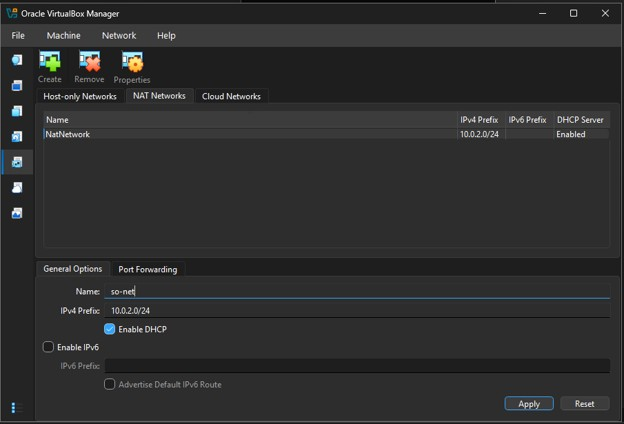

---

## 3. VirtualBox VM Configuration

### 3.1 Create the VM

1. Open VirtualBox → **New**
2. **Name:** `SecurityOnion-2.4`
3. **ISO Image:** select `securityonion-2.4.211-20260407.iso` (VirtualBox auto-detects OS type Linux, distribution Oracle Linux, version 9.x)
4. Leave **Proceed with Unattended Installation** checked → **Next**

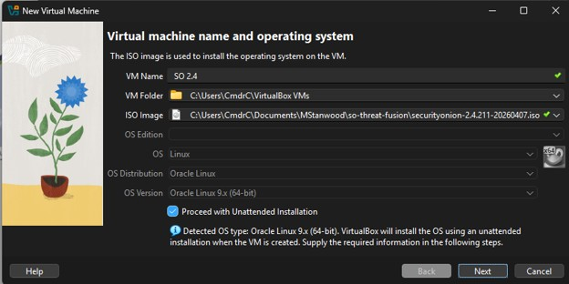

5. Enter a **User Name**, **Password**, and **Host Name** for the guest OS (e.g. `onionsec`) → **Next**

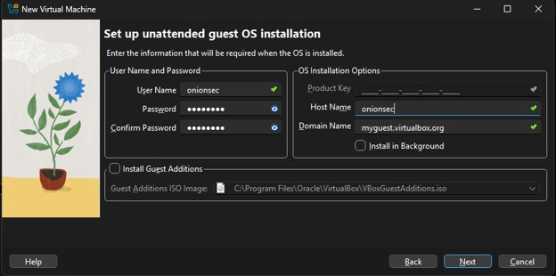

6. **Memory:** 16384 MB minimum
7. **Processors:** 4
8. **Hard disk:** 200 GB, dynamically allocated → **Finish**

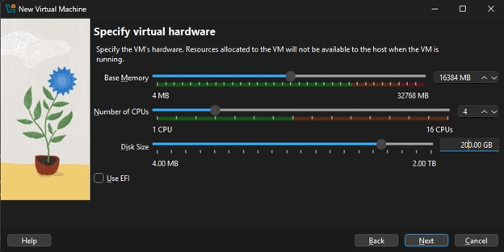

> **Known issue:** VirtualBox's unattended installation generates an answer-file ISO (`Unattended-<guid>-ks.cfg`) to inject the OS user from step 5. If that file already exists from a prior attempt in the same VM folder, the VM aborts on first boot with a storage error (`VERR_ALREADY_EXISTS`) — this is what happened during testing. The fix is to attach the real SO ISO manually ([§3.2](#32-storage--attach-the-iso)) and reconfigure networking ([§3.3](#33-network-adapters)), then restart and confirm the file-deletion prompt (see [§4.1](#41-boot-and-install-the-os)). If you'd rather avoid the error entirely, check **Skip Unattended Installation** in step 4 instead and create the OS user manually when the installer boots.
>
> 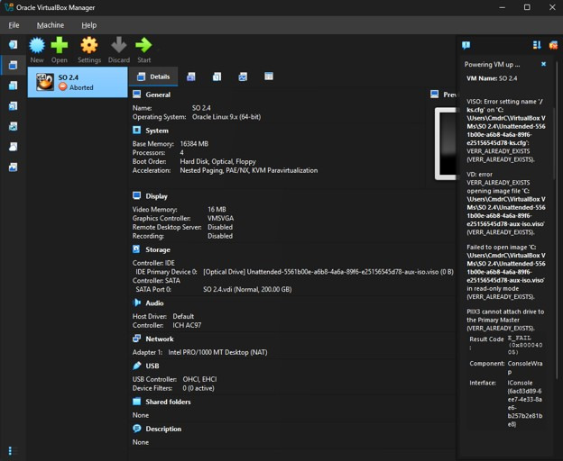

### 3.2 Storage — Attach the ISO

Settings → **Storage → Controller: IDE → Empty (CD icon)**

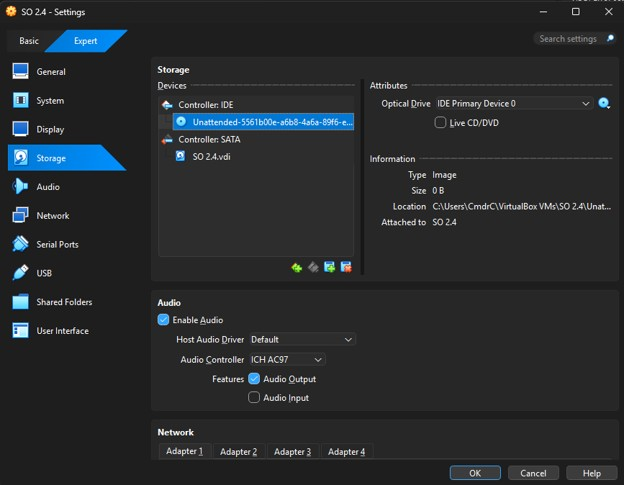

- Click the CD icon on the right → **Choose a disk file**
- Select: `securityonion-2.4.211-20260407.iso`

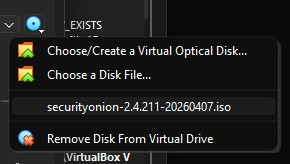

### 3.3 Network Adapters

Two adapters total. Power off the VM before changing network settings.

| Adapter | Mode | Name | Role | Promiscuous | Linux interface |
|---|---|---|---|---|---|
| Adapter 1 | NAT Network | `so-net` | Management + internet | Deny | `enp0s3` |
| Adapter 2 | Internal Network | `internal-net` | Monitoring (capture) | Allow All | `enp0s8` |

**Adapter 1 — Management + Internet**

Settings → **Network → Adapter 1**

| Field | Value |
|---|---|
| Enable Network Adapter | ✓ |
| Attached to | **NAT Network** |
| Name | `so-net` |
| Adapter Type | Paravirtualized Network (virtio-net) |
| Promiscuous Mode | Deny |

SO gets a DHCP address on `10.0.2.0/24` (typically `10.0.2.15`). This adapter handles internet access for package downloads and rule updates, and is selected as SO's management NIC during setup.

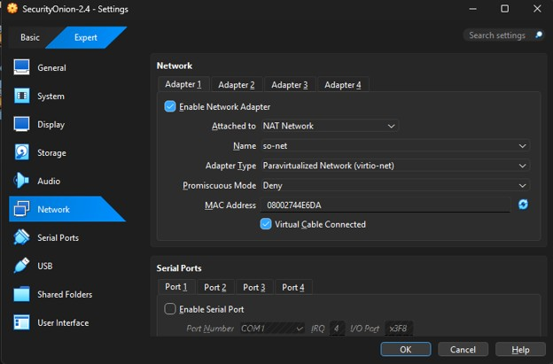

**Adapter 2 — Monitoring interface**

Settings → **Network → Adapter 2**

| Field | Value |
|---|---|
| Enable Network Adapter | ✓ |
| Attached to | **Internal Network** |
| Name | `internal-net` |
| Adapter Type | Paravirtualized Network (virtio-net) |
| Promiscuous Mode | **Allow All** |

SO puts this interface into promiscuous mode so Zeek and Suricata capture all traffic on `internal-net`, not only traffic addressed to this VM.

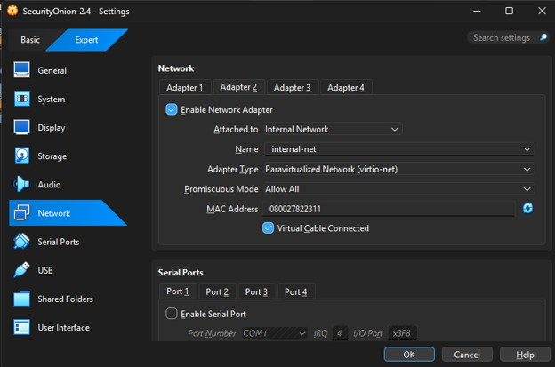

### 3.4 Accessing SO from Outside the VM

SO's web UI and Elasticsearch API are on the `so-net` NAT Network (`10.0.2.x`). Your Windows host cannot reach this network directly — only VMs on `so-net` can. Use the **Kali Linux VM** (section 6) as your analyst workstation to reach the SO web UI and run Python scripts against the Elasticsearch API.

---

## 4. Installation

### 4.1 Boot and Install the OS

1. If you hit the unattended-install storage error in [§3.1](#31-create-the-vm), restart the VM now. If prompted to delete leftover unattended-installation files, choose **Yes** — this clears the failed attempt before the installer boots.
2. Start the VM (or continue on from the restart above).
3. The SO installer screen appears. Type `yes` and press Enter when warned that all data will be erased.

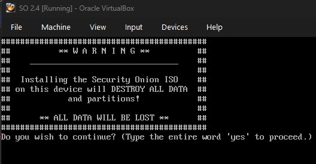

4. Create a Linux OS user (e.g. `onionsec`) and password. This is the console login — separate from the SOC web UI account created later.
5. The OS installs (~10–15 min). When prompted, **Restart**.
6. After restart, log in with the OS user. The SO setup wizard launches automatically.

### 4.2 SO Setup Wizard

Work through each screen using arrow keys and Enter.

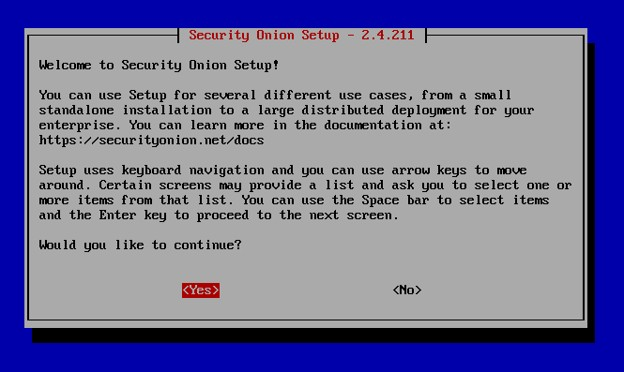

**Step 1 — Installation type**
- Select: **STANDALONE**

**Step 2 — Agree**
- Type: `AGREE`

**Step 3 — Hostname**
- Enter a hostname, e.g. `securityonion-ms`

**Step 3b — Description**
- Enter a short description for this node, e.g. `onionsec-ms` (shown later in the setup summary)

**Step 4 — Management Interface**
- Select the NIC whose MAC matches **Adapter 1** (NAT Network `so-net`). It appears as `enp0s3`.
- Note: MAC addresses are shown in both the VirtualBox adapter settings and the NIC selection screen — match them to pick the right one.

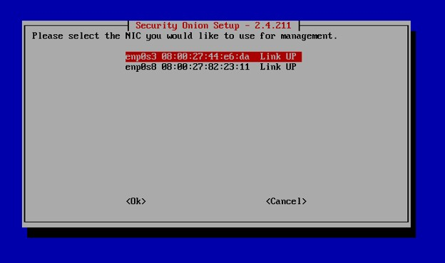

**Step 5 — Address assignment**
- Select: **DHCP**
- SO will receive an address on `10.0.2.0/24` (typically `10.0.2.15`)

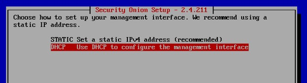

**Step 6 — Internet access**
- Select: **Direct** (no proxy)
- Keep default Docker IP range: **Yes**


**Step 7 — Monitoring interface**
- Select the NIC matching **Adapter 2** (Internal Network). It appears as `enp0s8`.
- Use Space to select it, then Enter to confirm.
- This interface goes into promiscuous mode — no IP is assigned.

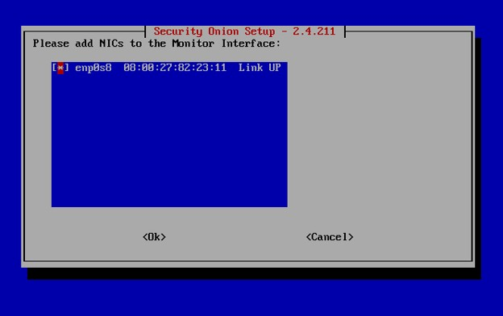

**Step 8 — SOC web UI admin account**
- Enter the admin email (e.g. `yourname@example.com`) — used to log in to the SOC web UI
- Enter and confirm the admin password

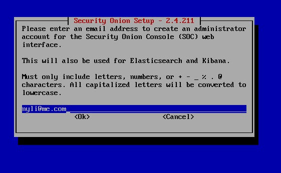

**Step 9 — Web interface access method**
- Select: **IP** (use IP address to access the web interface)
- Allow access via web interface: **Yes**

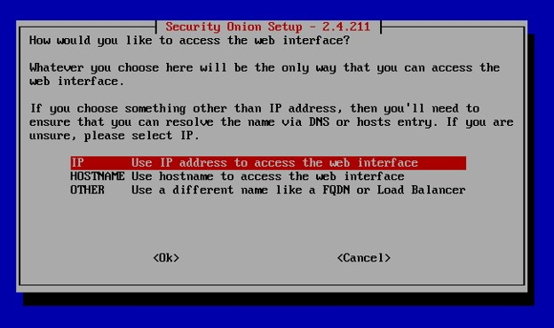


**Step 10 — Access control**
- Enter the subnet allowed to reach the web UI:
  ```
  10.0.2.0/24
  ```
  This covers the entire NAT Network, including the Kali VM.

**Step 11 — Review and confirm**
- Review the summary. Verify:
  - Management NIC: `enp0s3`
  - Management IP: `10.0.2.15` (or similar)
  - Allowed subnet: `10.0.2.0/24`
- Confirm with **Yes**.
- SO installs all services via Salt. This takes **20–30 minutes**. High CPU activity is normal.

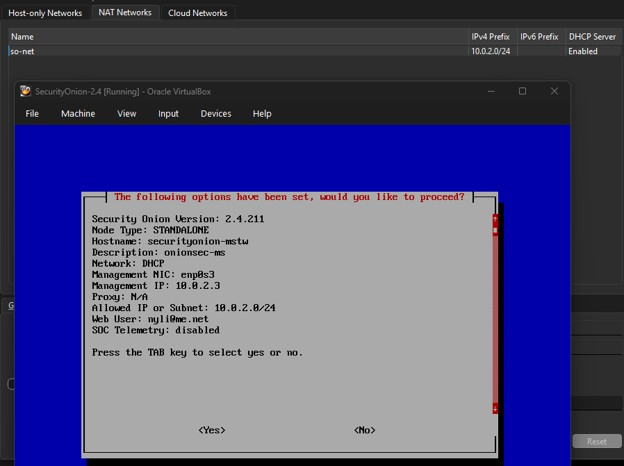

When complete, SO displays the web UI URL and login info. **Note the management IP** — you will use it from Kali.

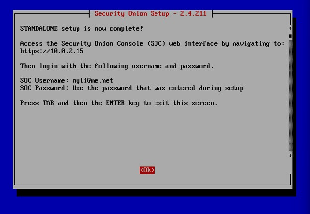

---

## 5. Post-Install Verification

### 5.1 Check SO services on the console

```bash
sudo so-status
```

All major services should show `running`:

| Service | What it does |
|---|---|
| `so-elasticsearch` | Core indexed storage |
| `so-kibana` | Visualization |
| `so-logstash` | Log parsing pipeline |
| `so-zeek` | Network protocol metadata |
| `so-suricata` | IDS alerts + PCAP |
| `so-soc` | The SOC web UI |
| `so-elastic-fleet` | Elastic Agent fleet manager |

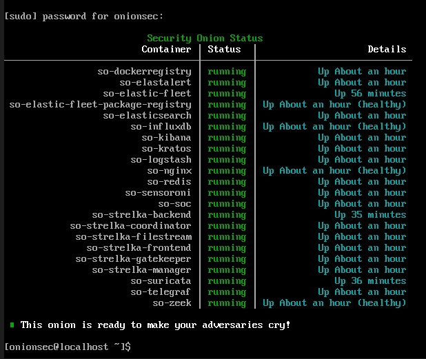

If any service shows `failed`:
```bash
sudo so-restart
# Wait 2–3 minutes, then:
sudo so-status
```

### 5.2 Access the SOC web UI

From the **Kali VM** (see section 6), open a browser and navigate to:
```
https://<SO_MANAGEMENT_IP>
```
where `<SO_MANAGEMENT_IP>` is the IP shown at the end of the SO setup wizard (typically `10.0.2.15`).

- Accept the self-signed certificate warning.
- Log in with the admin email and password set in the wizard.
- You should see the Security Onion Console with Alerts, Hunt, and Dashboards views.

---

## 6. Kali Linux VM Setup

Kali serves two roles: **analyst workstation** (web UI + API access via `so-net`) and **attacker/injector VM** (traffic generation on `internal-net` captured by SO).

### 6.1 Create the Kali VM

Download the pre-built Kali VM from kali.org → **Virtual Machines → VirtualBox** (a `.7z` archive containing a ready-to-use `.vbox` project and disk image — not the installer ISO). Extract it, then double-click the `.vbox` file to register and open it directly in VirtualBox.

**Default Kali VM login:**

| Field | Value |
|---|---|
| Username | `kali` |
| Password | `kali` |

### 6.2 Network Adapters for Kali

| Adapter | Mode | Name | Adapter Type | Promiscuous | Role |
|---|---|---|---|---|---|
| Adapter 1 | NAT Network | `so-net` | Paravirtualized Network (virtio-net) | Deny | Internet + SO web UI access |
| Adapter 2 | Internal Network | `internal-net` | Paravirtualized Network (virtio-net) | **Allow All** | Traffic injection + Wireshark capture |

Traffic Kali sends on **Adapter 2** (`internal-net` → typically `eth1`) is captured by SO's monitoring interface. Traffic on **Adapter 1** (`so-net` → `eth0`) reaches the SO management interface for web UI and API access.

Adapter 2 does not need promiscuous mode to inject traffic (Kali is sending, not sniffing), but Allow All lets you run Wireshark on `eth1` to verify what SO is actually receiving from tcpreplay or live attacks.

### 6.3 Verify Connectivity and Access the SOC Web UI

1. Start the Kali VM and log in with the default credentials (`kali` / `kali`).
2. Open a terminal and identify Kali's IP on `so-net`:
   ```bash
   ifconfig
   ```
3. Ping the Security Onion management IP to confirm connectivity across `so-net`:
   ```bash
   ping <SO_MANAGEMENT_IP>
   ```
4. Open a browser in Kali and navigate to:
   ```
   https://<SO_MANAGEMENT_IP>
   ```
5. Log in with the SOC admin email and password created during the SO setup wizard ([§4.2, Step 8](#42-so-setup-wizard)).

