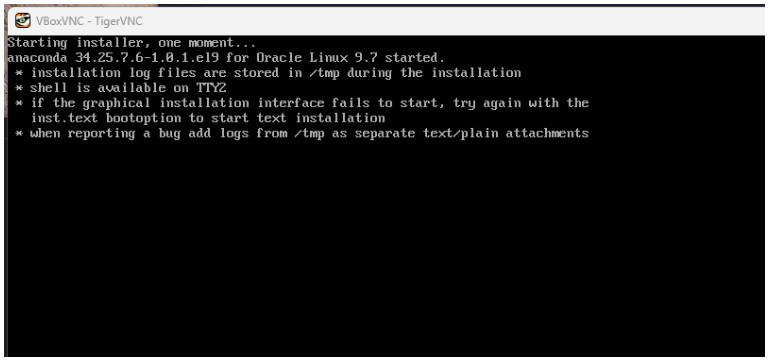
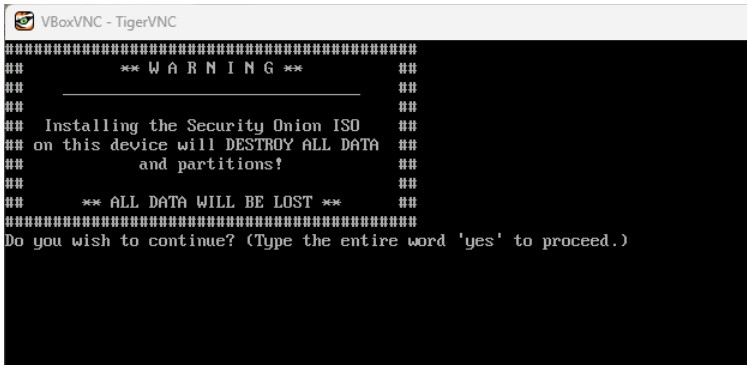
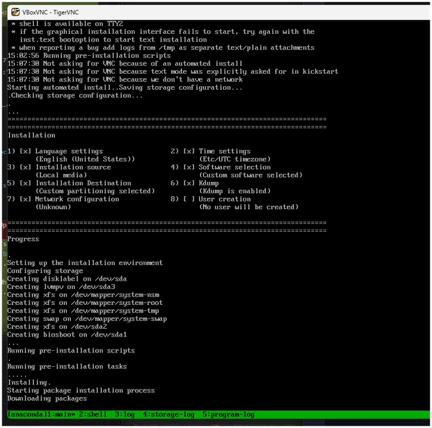
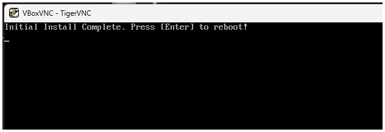
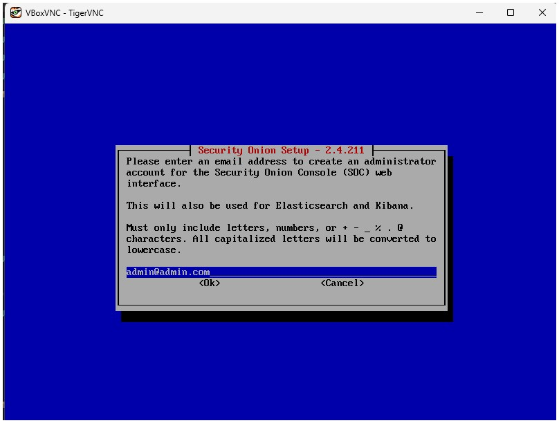
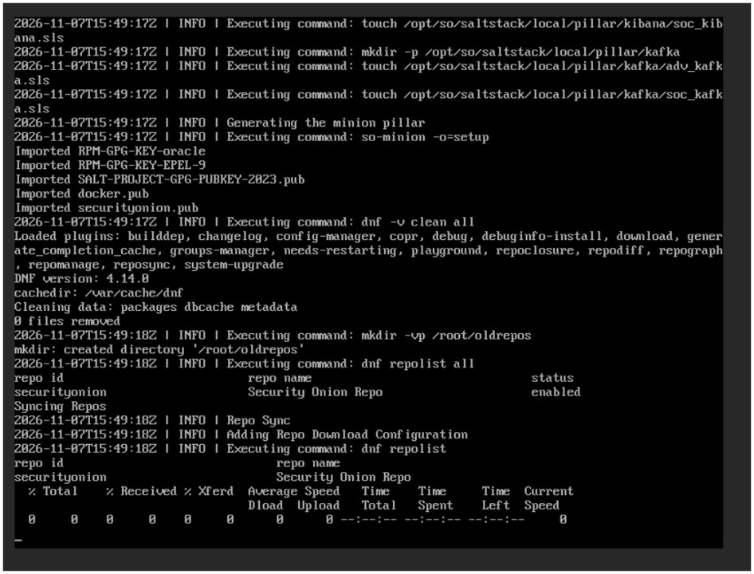
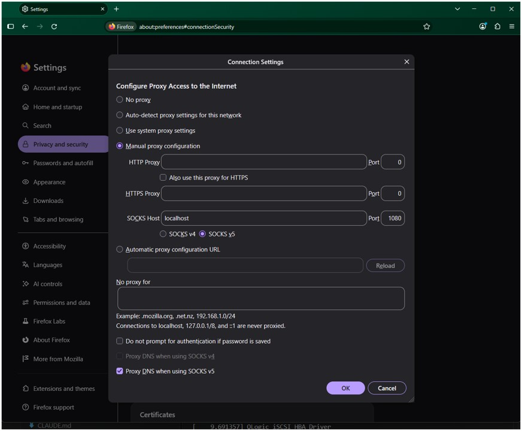

# Security Onion 2.4 — Standalone Installation on the UPM Server (VirtualBox, headless)

**SO version:** 2.4.211  
**Deployment type:** Standalone (all components on one VM)  
**Server:** `b5g-bigtwin02.dit.upm.es` (138.4.21.13), Ubuntu 22.04, SSH only  
**Reference:** https://docs.securityonion.net/en/2.4/installation.html  
**Design and full troubleshooting:** [SO-plan-for-upm-server-VirtualBox.md](SO-plan-for-upm-server-VirtualBox.md)  
**Laptop version of this guide:** [SO-install-[local-virtualbox].md](SO-install-[local-virtualbox].md)

---

## 1. VM Specifications

| Resource | Value |
|---|---|
| VM name | `so-standalone` |
| RAM | 64 GB = 65536 MB |
| CPU cores | 16 |
| Disk | 400 GB VDI, dynamically allocated |
| Network adapters | 2 |

| Adapter | Mode | Name | Role | Promiscuous |
|---|---|---|---|---|
| NIC 1 | NAT Network | `so-net` (`10.0.2.0/24`, DHCP) | Management + internet | Deny |
| NIC 2 | Internal Network | `internal-net` | Monitoring (capture) | Allow All |

The server has no screen, so everything is reached from the laptop through SSH. These ports are bound to `127.0.0.1` on the server and are not published on the university network:

| Server port | Goes to | Used for |
|---|---|---|
| 5901 | VM console (VNC) | Installer and console |
| 8443 | `10.0.2.4:443` | Dashboard health check used by the scripts |
| 2222 | `10.0.2.4:22` | SSH into the SO VM, and the SOCKS proxy for the web UI |

---

## 2. Prerequisites

On the laptop:

- Connection to the **UPM VPN**
- SSH access to the server as `marylin`
- **TigerVNC Viewer**. The server has the open-source VNC Extension Pack, so Windows Remote Desktop can't connect to the console.
- The SO ISO, unless you download it directly on the server

Connect to the server and check it is ready:

```bash
ssh marylin@b5g-bigtwin02.dit.upm.es
```

| Check | Command | Expected |
|---|---|---|
| VirtualBox installed | `VBoxManage --version` | A version such as `6.1.50` |
| Kernel driver loaded | `lsmod \| grep vboxdrv` | A `vboxdrv` line |
| Extension Pack | `VBoxManage list extpacks` | VNC pack, `Usable: true` |
| No KVM VMs running | `ps aux \| grep -c [q]emu-system` | `0` |
| Disk space | `df -h ~` | At least 400 GB free on `/` |

> **Shared server:** run every `VBoxManage` command as `marylin`, without `sudo`. VMs belong to the user who creates them. Ask the tutor before making any change that affects the whole host.

---

## 3. Create the VM

### 3.1 Copy the scripts to the server

From the laptop (PowerShell, in the repository root):

```powershell
scp .\docs\install\scripts\* marylin@b5g-bigtwin02.dit.upm.es:~/
```

On the server:

```bash
sed -i 's/\r$//' ~/[0-9].*.sh     # strip Windows line endings, if any
ls ~/[0-9].*                      # the files of docs/install/scripts
```

| Script | Purpose |
|---|---|
| `0.download-so-bash.sh` | Downloads the ISO and verifies its checksum and signature |
| `1.so-vbox-create.sh` | Creates the NAT Network, the VM, its disk, NICs and console |
| `2.so-vbox-boot-installer.sh` | Boots the installer with readable output |
| `3.so-vbox-afterinstall.sh` | Adds the port-forwards, then takes the clean snapshot |
| `4.so-vbox-fix-forwards.sh` | Detects the VM's current IP and repairs the port-forwards |

### 3.2 Get the ISO onto the server

The account's `sudo` is limited, so the ISO goes in the home folder:

```bash
mkdir -p ~/isos
cd ~/isos
bash ~/0.download-so-bash.sh
```

Or copy it from the laptop (PowerShell, in the folder with the ISO):

```powershell
scp .\securityonion-2.4.211-20260407.iso marylin@b5g-bigtwin02.dit.upm.es:~/isos/
```

### 3.3 Run the VM script

On the server:

```bash
bash ~/1.so-vbox-create.sh
```

When asked, create a VNC console password. Don't reuse your server password. VNC only uses the first 8 characters.

🔑 **Lab VNC password (shared with the tutor):** `1q2w3e4r`

> ⚠️ **Security:** this password is documented on purpose so the tutor can open the console, and is acceptable only in this isolated lab. In production, keep a randomly generated password in a vault, and use a console with TLS and per-user login. See [§11 of the plan](SO-plan-for-upm-server-VirtualBox.md#11-security-lab-shortcuts-vs-production-practice).

The script ends by checking that the disk is attached to SATA port 0. It stops if the VM already exists. To start over:

```bash
VBoxManage unregistervm so-standalone --delete
```

To run the creation one command at a time, with a check and an undo for each change, follow [so-vbox-create-step-by-step.md](so-vbox-create-step-by-step.md) instead.

---

## 4. Installation

### 4.1 Boot the Installer and Open the Console

1. On the laptop, open the console tunnel and leave the window open:
   ```powershell
   ssh -L 5901:127.0.0.1:5901 marylin@b5g-bigtwin02.dit.upm.es
   ```
2. On the server, boot the installer:
   ```bash
   bash ~/2.so-vbox-boot-installer.sh
   ss -tln | grep 5901          # must show 127.0.0.1:5901, not 0.0.0.0
   ```
3. Connect **TigerVNC Viewer** to `localhost:5901` with the VNC password.

> **Why a boot script instead of a plain `startvm`:** with a plain start, the Oracle Linux boot splash (a row of dots) covers the screen and the installer runs, or fails, invisibly behind it. The script adds `plymouth.enable=0` at the boot menu for this boot only.

Scrolling kernel messages appear first. Three lines reading `vmwgfx … *ERROR* … unsupported hypervisor … likely broken` are harmless. The installer then starts:



> **Known issue:** if TigerVNC stays on dots or a black screen for more than a minute, switch to the installer's console with **Ctrl+Alt+F1**. If the viewer catches that key combination, send it from the server:
> ```bash
> VBoxManage controlvm so-standalone keyboardputscancode 1d 38 3b bb b8 9d
> ```

### 4.2 Install the OS

1. Click inside the TigerVNC window. Type `yes` and press Enter when warned that all data will be erased. This only affects the VM's virtual disk.



2. Create a Linux OS user (e.g. `onionsec`) and password. This is the console and SSH login, separate from the SOC web UI account created later.
3. The OS installs (~10–15 min). It reads its packages from the ISO, so **don't eject the ISO yet**.



4. When the screen shows **Initial Install Complete. Press [Enter] to reboot!**, don't press Enter yet.



5. Eject the ISO from the server. The boot order is DVD first, so otherwise the VM would start the installer again:
   ```bash
   VBoxManage storageattach so-standalone --storagectl IDE --port 1 --device 0 --type dvddrive --medium emptydrive
   ```
6. Press Enter in TigerVNC to reboot.
7. After the restart, log in with the OS user. The SO setup wizard launches automatically.

> **Known issue:** if it already rebooted into the SO boot menu, eject the ISO as above and then run `VBoxManage controlvm so-standalone reset`.

### 4.3 SO Setup Wizard

Work through each screen using arrow keys and Enter. The screens are the same as in the [laptop guide](SO-install-[local-virtualbox].md#42-so-setup-wizard), which has a capture of each one.

**Step 1 — Installation type**
- Select: **STANDALONE**

**Step 2 — Agree**
- Type: `AGREE`

**Step 3 — Hostname**
- Enter a hostname, e.g. `securityonion-ms`

**Step 3b — Description**
- Enter a short description for this node

**Step 4 — Management Interface**
- Select the NIC whose MAC matches **NIC 1** (NAT Network `so-net`), usually `enp0s3`.
- Check the MAC addresses from the server, because the NIC names can differ:
  ```bash
  VBoxManage showvminfo so-standalone | grep MAC
  ```

**Step 5 — Address assignment**
- Select: **DHCP**
- SO will receive an address on `10.0.2.0/24` (expect `10.0.2.4`)

**Step 6 — Internet access**
- Select: **Direct** (no proxy)
- Keep default Docker IP range: **Yes**

**Step 7 — Monitoring interface**
- Select the NIC whose MAC matches **NIC 2** (Internal Network), usually `enp0s8`.
- Use Space to select it, then Enter to confirm.

**Step 8 — SOC web UI admin account**
- Enter the admin email (e.g. `admin@admin.com`). It is also used for Elasticsearch and Kibana.
- Enter and confirm the admin password



**Step 9 — Web interface access method**
- Select: **IP**
- Allow access via web interface: **Yes**

**Step 10 — Access control**
- Enter the subnet allowed to reach the web UI:
  ```
  10.0.2.0/24
  ```
  This covers port-forwarded connections from the server and any VM on `so-net`.

> ⚠️ **Security:** this range lets every VM on `so-net` reach the SOC login page, which is convenient for a lab. In production, allow only specific analyst IPs or a dedicated management subnet, and give each person their own SOC account.

**Step 11 — Review and confirm**
- Review the summary. Verify:
  - Management NIC: the one matching NIC 1
  - Management IP: `10.0.2.4` (or similar)
  - Allowed subnet: `10.0.2.0/24`
- Confirm with **Yes**.
- SO installs all services via Salt, which took **20–30 minutes** on the laptop. High CPU activity is normal, and the log can sit at 0% during a package download for some time. This is normal too.



When complete, SO displays the web UI URL and login info. **Note the management IP**: the next section needs it.

---

## 5. Post-Install Verification

### 5.1 Add the Port-Forwards

On the server:

```bash
bash ~/3.so-vbox-afterinstall.sh
```

If the wizard showed an address other than `10.0.2.4`:

```bash
SO_IP=10.0.2.x bash ~/3.so-vbox-afterinstall.sh
```

The script shows ports 8443 and 2222 listening on the server and prints the commands to use from the laptop. Confirm the VM's real address first with `ip -br a` on the console: the wizard's DHCP address isn't always `10.0.2.4`.

### 5.2 Log In over SSH

From the laptop:

```powershell
ssh -J marylin@b5g-bigtwin02.dit.upm.es -p 2222 onionsec@127.0.0.1
```

> **Tip:** TigerVNC doesn't let you copy and paste into the VM. Use this SSH session for anything you'd rather paste than type.

### 5.3 Check SO Services

```bash
sudo so-status
```

> **Known issue:** after any reboot, `so-status` first prints *System appears to be starting. No highstate has completed since the system was restarted.* This is not a failure. Salt is still configuring the system and starting its containers. Allow 15–30 minutes and run the command again.

All major services should show `running`:

| Service | What it does |
|---|---|
| `so-elasticsearch` | Core indexed storage |
| `so-kibana` | Visualization |
| `so-logstash` | Log parsing pipeline |
| `so-zeek` | Network protocol metadata |
| `so-suricata` | IDS alerts + PCAP |
| `so-soc` | The SOC web UI |
| `so-elastic-fleet` | Elastic Agent fleet manager |

If a service has failed, restart that component. `so-restart` needs its name:

```bash
sudo so-restart logstash     # or the component-specific script: sudo so-logstash-restart
# Wait 2–3 minutes, then:
sudo so-status
```

### 5.4 Access the SOC Web UI

SO redirects the browser to the address chosen during setup (`https://10.0.2.4`), which the laptop can't reach, so a plain tunnel to `localhost` doesn't work. Use a SOCKS proxy running inside the SO VM instead:

1. From the laptop, open this connection and leave the window open:
   ```powershell
   ssh -J marylin@b5g-bigtwin02.dit.upm.es -p 2222 -D 1080 onionsec@127.0.0.1
   ```
2. Create a separate Firefox profile for the lab, so the proxy doesn't affect your normal browsing. You only need to do this once:
   - Browse to `about:profiles` and click **Create a New Profile**.
   - Give it a name (e.g. `so-lab`) and click **Finish**.
   - Click **Launch profile in new browser** under the new profile. Use this window for the next steps.

3. In the new profile, go to **Settings → Network Settings → Settings…** and set:

   | Field | Value |
   |---|---|
   | Configuration | **Manual proxy configuration** |
   | SOCKS Host | `localhost` |
   | Port | `1080` |
   | SOCKS version | **SOCKS v5** |
   | Proxy DNS when using SOCKS v5 | ✓ |

   

4. Browse to `https://10.0.2.4`, accept the self-signed certificate warning, and log in with the admin email and password from the wizard.

Next time, open the profile from `about:profiles` with **Launch profile in new browser**. It keeps the proxy settings, but the SSH connection from step 1 must be open.

> ⚠️ **Security:** accepting a self-signed certificate is fine in the lab, because the traffic stays inside the SSH connection. In production, install a certificate from the organisation's CA.

---

## 6. Snapshot the Clean Install

Run this only after `so-status` shows the services running. On the server:

```bash
bash ~/3.so-vbox-afterinstall.sh snapshot
```

Answer `y` at the prompt. The script shuts the VM down cleanly, makes sure the ISO is ejected, takes the `clean-install` snapshot and starts the VM again. It takes no snapshot if the VM hasn't shut down after 10 minutes.

This snapshot is the reset point for the teaching lab and the TFM scenarios. The VM reboots afterwards, so expect the highstate message from [§5.3](#53-check-so-services) again.

---

## 7. Daily Use

| Task | Command (on the server unless noted) |
|---|---|
| Connect to the server | `ssh marylin@b5g-bigtwin02.dit.upm.es` (VPN first) |
| List running VMs | `VBoxManage list runningvms` |
| Start SO | `VBoxManage startvm so-standalone --type headless` |
| Stop SO cleanly | `VBoxManage controlvm so-standalone acpipowerbutton` |
| Force off (last resort) | `VBoxManage controlvm so-standalone poweroff` |
| Console | Laptop: `ssh -L 5901:127.0.0.1:5901 marylin@b5g-bigtwin02.dit.upm.es`, then VNC viewer to `localhost:5901` |
| Web UI | Laptop: `ssh -J marylin@b5g-bigtwin02.dit.upm.es -p 2222 -D 1080 onionsec@127.0.0.1`, then `https://10.0.2.4` in the lab Firefox profile ([§5.4](#54-access-the-soc-web-ui)) |
| SSH into SO | Laptop: `ssh -J marylin@b5g-bigtwin02.dit.upm.es -p 2222 onionsec@127.0.0.1` |
| Reset to clean install | `VBoxManage controlvm so-standalone poweroff`, then `VBoxManage snapshot so-standalone restore clean-install` |

---

## 8. Troubleshooting

| Symptom | What to do |
|---|---|
| Dots or a black screen during the install boot | Boot with `2.so-vbox-boot-installer.sh`, and try Ctrl+Alt+F1 ([§4.1](#41-boot-the-installer-and-open-the-console)) |
| Installer stops with `/tmp/part-include: No such file or directory` | No disk is attached. Check with `VBoxManage showvminfo so-standalone --machinereadable \| grep SATA-0-0` |
| The VM boots the installer again after the OS install | The ISO wasn't ejected ([§4.2](#42-install-the-os)) |
| `so-status` says no highstate has completed | Wait ([§5.3](#53-check-so-services)) |
| Port-forward doesn't answer, or `ssh -J` ends with `Connection closed` | Run `bash ~/4.so-vbox-fix-forwards.sh` on the server. It detects the VM's current IP, repoints the forwards and tests them |
| `VBoxManage list vms` doesn't show the VM | Run it as `marylin`, without `sudo` |

For the full list and the debugging commands, see [§8 of the plan](SO-plan-for-upm-server-VirtualBox.md#8-troubleshooting).
