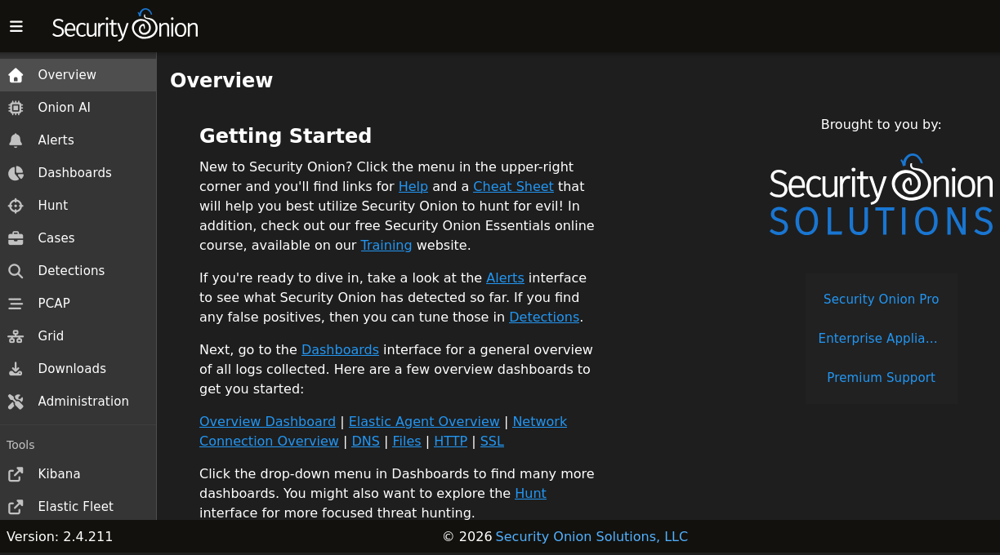
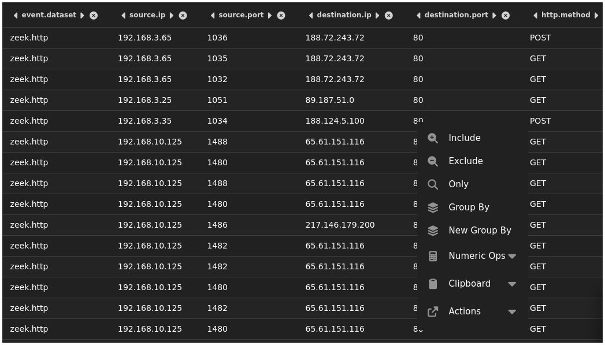
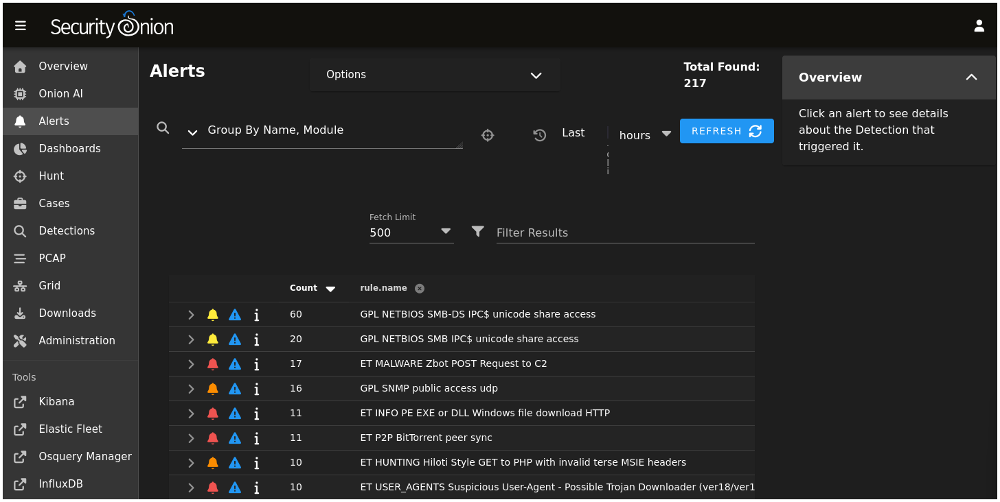
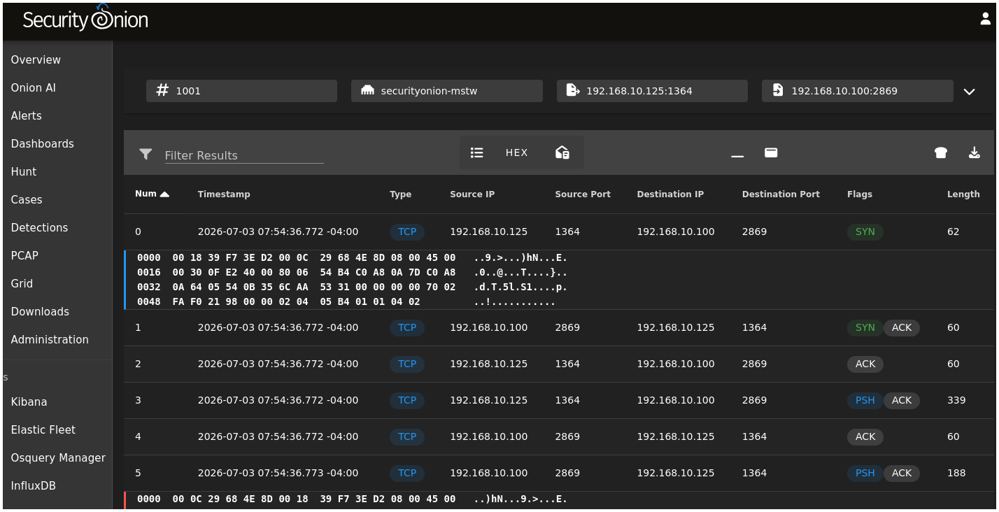
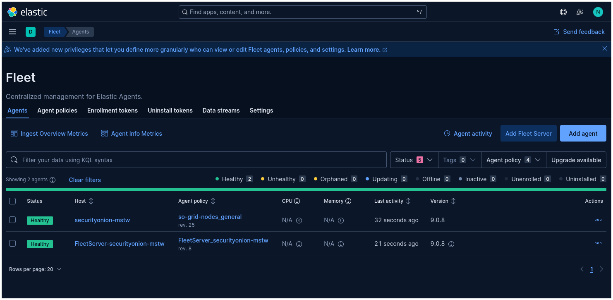
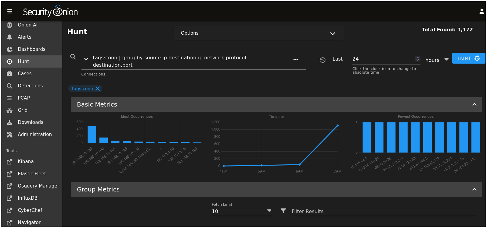

# Security Onion 2.4 — Feature & Capability Survey
## Lab Reference Document — Draft 1 (Organized by The most important features)

 Security Onion is an open-source Linux distribution designed for network security monitoring (NSM), intrusion detection, and log management. It integrates multiple tools under a single unified web interface — the Security Onion Console (SOC).

**SO version:** 2.4.211 

In this lab, SO runs as a **standalone node**: all components (sensors, storage, and UI) are on one virtual machine. The architecture looks like this:

```
Traffic on internal-net
        ↓
  [ Zeek ]      → network protocol metadata (conn, DNS, HTTP, SSL…)
  [ Suricata ]  → IDS signature alerts + PCAP
        ↓
  [ Logstash ]  → parsing and ECS normalization
        ↓
  [ Elasticsearch ] → indexed storage
        ↓
  [ SOC Web UI ]    → Alerts · Hunt · Dashboards · PCAP · Cases
```

Endpoint telemetry (Windows event logs, Sysmon) flows through **Elastic Agent**, deployed on monitored hosts, and lands in the same Elasticsearch storage.

All log data is normalized to the **Elastic Common Schema (ECS)** — a standardized field naming convention that makes querying consistent regardless of the original log source.

---

## Section 1 — Security Onion Console (SOC)

The SOC is the unified web interface for Security Onion.

**Access:** `https://<SO_MANAGEMENT_IP>` from the Kali VM. Log in with the admin email and password set during installation.



### Main Views

| View | Purpose |
|---|---|
| **Alerts** | Suricata IDS alerts, grouped by severity and rule name. The primary triage view. |
| **Hunt** | Free-form search across all Elasticsearch indices. Used for threat hunting and ad-hoc investigation. |
| **Dashboards** | Pre-built Kibana dashboards for Zeek, Suricata, and endpoint data. |
| **PCAP** | Retrieve and download raw packet captures for a specific alert or time window. |
| **Cases** | Lightweight case management — attach alerts, add notes, track investigation status. |
| **Grid (Administration)** | SO configuration via Salt. Adjust component settings, manage users, apply rule updates. |


### Key Fields Visible Everywhere

| ECS Field | Meaning |
|---|---|
| `@timestamp` | Event time (UTC) |
| `source.ip` / `destination.ip` | Network endpoints |
| `source.port` / `destination.port` | Transport layer ports |
| `event.dataset` | Which log type produced this record (e.g. `zeek.dns`, `suricata.alert`) |
| `event.severity` | Numeric severity (Suricata alerts) |
| `observer.name` | The SO sensor that generated the event |

---

## Zeek

Zeek is a network analysis framework. It produces structured **metadata logs** for every observed network connection and protocol interaction.

Zeek runs on SO's monitoring interface (ej: `enp0s_`) in promiscuous mode. Every packet on `internal-net` is inspected.

### Log Types

Each log type maps to an Elasticsearch index (data stream) under `logs-zeek-*`.

| Log | `event.dataset` value | What it captures |
|---|---|---|
| `conn.log` | `zeek.conn` | Every TCP/UDP/ICMP flow: duration, bytes, state |
| `dns.log` | `zeek.dns` | DNS queries and responses |
| `http.log` | `zeek.http` | HTTP requests: method, URI, status code, user-agent |
| `ssl.log` | `zeek.ssl` | TLS handshake metadata: SNI, cipher, certificate validity |
| `files.log` | `zeek.files` | File transfers: MIME type, MD5/SHA1 hash, source |
| `weird.log` | `zeek.weird` | Protocol anomalies Zeek cannot parse cleanly |
| `notice.log` | `zeek.notice` | Zeek's own detection notices (e.g. scanning behaviour) |



### Example Record

`<log record example here: zeek.conn record for a TCP connection, showing source.ip, destination.ip, destination.port, network.bytes, network.transport, zeek.conn.state>`

### Key ECS Fields for Queries

| ECS Field | Zeek source | Typical query use |
|---|---|---|
| `event.dataset` | all Zeek logs | Filter to a specific log type |
| `source.ip` | conn, dns, http… | Who initiated the connection |
| `destination.ip` | conn, dns, http… | Who was contacted |
| `destination.port` | conn | What service was targeted |
| `network.protocol` | conn | `tcp`, `udp`, `icmp` |
| `network.bytes` | conn | Total bytes transferred |
| `dns.question.name` | dns | The domain queried |
| `dns.question.type` | dns | `A`, `AAAA`, `MX`, `TXT`… |
| `http.request.method` | http | `GET`, `POST`, `PUT`… |
| `http.request.body.uri` | http | The requested URI path |
| `http.response.status_code` | http | `200`, `404`, `500`… |
| `user_agent.original` | http | Browser or tool user-agent string |
| `tls.server_name` | ssl | SNI hostname in TLS handshake |
| `file.hash.md5` | files | File hash for threat intel lookups |

### Sample Hunt Queries

```
# All DNS queries in the last hour
event.dataset: zeek.dns AND @timestamp > now-1h

# Connections to port 445 (SMB)
event.dataset: zeek.conn AND destination.port: 445

# HTTP requests to a suspicious URI
event.dataset: zeek.http AND http.request.body.uri: *passwd*
```

---

## Suricata

Suricata is a signature-based **Intrusion Detection System (IDS)**. It inspects packets against a ruleset and generates an alert when traffic matches a known-bad pattern. In SO, Suricata also writes **full packet captures (PCAP)** for each alert, allowing retrospective packet-level analysis.

SO ships with the **Emerging Threats Open** ruleset pre-loaded.



### Alert Structure

Each Suricata alert includes:

- **Rule name** (`rule.name`) — human-readable description, e.g. `ET SCAN Nmap -sS window 2048`
- **Signature ID** (`rule.id`) — numeric Suricata SID
- **Severity** (`event.severity`) — 1 (Critical) to 4 (Informational) in Suricata's scale
- **Category** (`rule.category`) — e.g. `Attempted Reconnaissance`, `Malware Command and Control`
- **Network 5-tuple** — source IP/port, destination IP/port, protocol

### Example Record

`<log record example here: suricata.alert record showing rule.name, rule.id, rule.category, event.severity, source.ip, destination.ip, destination.port>`

### Key ECS Fields for Student Queries

| ECS Field | Meaning |
|---|---|
| `event.dataset` | `suricata.alert` for IDS alerts |
| `rule.name` | The Suricata rule description |
| `rule.id` | Numeric signature ID (SID) |
| `rule.category` | Alert category |
| `event.severity` | 1 = Critical, 2 = Major, 3 = Minor, 4 = Info |
| `source.ip` | Attacker / originating host |
| `destination.ip` | Target host |
| `destination.port` | Targeted service port |
| `network.transport` | `tcp`, `udp` |

### Sample Hunt Queries

```
# All Suricata alerts, most recent first
event.dataset: suricata.alert

# High-severity alerts only (severity 1 or 2)
event.dataset: suricata.alert AND event.severity <= 2

# Alerts involving a specific source IP
event.dataset: suricata.alert AND source.ip: 10.0.2.100

# Alerts matching a keyword in the rule name
event.dataset: suricata.alert AND rule.name: *scan*
```

### PCAP Retrieval

For any Suricata alert, SO stores the associated raw packets. In the **Alerts** view:

1. Click on an alert row to expand it.
2. Click the **PCAP** icon.
3. SO retrieves the packet capture for that flow and offers a download.
4. Open in Wireshark for protocol-level inspection.



---

## Elastic Agent and Sysmon (Endpoint Telemetry)

Network sensors (Zeek, Suricata) only see traffic crossing the monitored interface. To observe what is happening **inside a host** — which processes ran, which files were created, which registry keys were modified — SO uses **Elastic Agent** deployed on endpoint VMs.

In Windows environments, Elastic Agent works alongside **Sysmon** (System Monitor), a Microsoft Sysinternals tool that logs detailed process, file, network, and registry activity to the Windows Event Log. Elastic Agent ships those events to SO's Elasticsearch.



### Sysmon Event IDs

Sysmon generates numbered event types. The most important for threat detection:

| Event ID | Name | What it records |
|---|---|---|
| 1 | Process Create | New process: name, PID, parent, command line, hash |
| 3 | Network Connection | Process making a network connection: IP, port, process |
| 5 | Process Terminate | Process exit |
| 7 | Image Load | DLL loaded by a process |
| 8 | CreateRemoteThread | Thread injection indicator |
| 10 | ProcessAccess | Process accessing another process's memory (credential dumping indicator) |
| 11 | File Create | File created or overwritten |
| 13 | Registry Value Set | Registry modification |
| 22 | DNS Query | DNS resolution by a process (which process queried what domain) |

### Example Record

`<log record example here: Sysmon Event ID 1 (Process Create) record showing process.name, process.command_line, process.parent.name, user.name, host.name, @timestamp>`

### Key ECS Fields for Student Queries

| ECS Field | Sysmon source | Meaning |
|---|---|---|
| `event.dataset` | all | `windows.sysmon_operational` |
| `event.code` | all | Sysmon Event ID (e.g. `1`, `3`, `22`) |
| `process.name` | 1, 3, 7… | Executable filename |
| `process.command_line` | 1 | Full command line with arguments |
| `process.executable` | 1 | Full path to the executable |
| `process.parent.name` | 1 | Parent process name |
| `process.hash.sha256` | 1 | Process image hash |
| `user.name` | 1, 11, 13 | OS user who triggered the event |
| `host.name` | all | Endpoint hostname |
| `network.destination.ip` | 3 | Outbound connection target |
| `network.destination.port` | 3 | Outbound connection port |
| `dns.question.name` | 22 | Domain queried by a specific process |
| `file.path` | 11 | Created or modified file path |
| `registry.path` | 13 | Registry key path modified |

### Sample Hunt Queries

```
# All Sysmon process creation events
event.dataset: windows.sysmon_operational AND event.code: 1

# PowerShell executions
event.dataset: windows.sysmon_operational AND event.code: 1 AND process.name: powershell.exe

# Process making a network connection to port 4444 (common reverse shell)
event.dataset: windows.sysmon_operational AND event.code: 3 AND network.destination.port: 4444

# DNS queries made by a specific process
event.dataset: windows.sysmon_operational AND event.code: 22 AND process.name: cmd.exe
```

---

## Elasticsearch and the Hunt Interface

**Elasticsearch** is the indexed storage layer that holds all SO data — Zeek logs, Suricata alerts, Sysmon events, and SO's own management data. Every event from every sensor lands here, normalized to ECS.

The **Hunt** interface in the SOC web UI is a search frontend over Elasticsearch. It supports three query languages:

| Language | Best for |
|---|---|
| **KQL** (Kibana Query Language) | Simple field:value filtering — recommended for beginners |
| **EQL** (Event Query Language) | Sequence detection — "process A then process B within 5 seconds" |
| **Lucene** | Advanced text search with regex and fuzzy matching |



### Index Structure

Data is stored in data streams named `logs-<source>-so`:

| Data stream | Contents |
|---|---|
| `logs-zeek-so` | All Zeek logs (conn, dns, http, ssl…) |
| `logs-suricata-so` | Suricata alerts and stats |
| `logs-windows-so` | Windows event logs + Sysmon |
| `logs-so.*` | SO internal management events |

In Hunt, select **All Indices** to search across everything, or narrow to a specific stream to reduce noise.

### Time Picker

All queries are scoped to a time window. The default is the last 24 hours. Lab exercises often require adjusting this to the window when traffic was injected.

`<Insert Screenshot here: time picker dropdown showing absolute time range selection>`

### Building Queries in KQL

KQL syntax:

```
field: value                        # exact match
field: value*                       # wildcard
field: value1 OR field: value2      # OR
field1: value1 AND field2: value2   # AND
NOT field: value                    # negation
field >= 100                        # numeric comparison
```

### Common Investigation Patterns

**Pattern 1 — Start from an alert, pivot to context**

```
# Step 1: Find the alert
event.dataset: suricata.alert AND source.ip: 10.0.2.100

# Step 2: What else was that IP doing? (switch to zeek.conn)
event.dataset: zeek.conn AND source.ip: 10.0.2.100

# Step 3: Did it resolve any suspicious domains?
event.dataset: zeek.dns AND source.ip: 10.0.2.100
```

**Pattern 2 — Follow a suspicious process on the endpoint**

```
# Step 1: Find the suspicious process creation
event.dataset: windows.sysmon_operational AND event.code: 1 AND process.name: mshta.exe

# Step 2: What network connections did it make?
event.dataset: windows.sysmon_operational AND event.code: 3 AND process.name: mshta.exe

# Step 3: Cross-reference with Zeek on the same destination IP
event.dataset: zeek.conn AND destination.ip: <IP from step 2>
```

**Pattern 3 — Temporal scoping (all events in a 2-minute window)**

```
@timestamp >= "2026-06-22T12:05:00" AND @timestamp <= "2026-06-22T12:07:00"
```

### ECS Quick Reference Card

The table below covers the fields most frequently used across all log sources in this lab.

| Field | Type | Source | Example value |
|---|---|---|---|
| `@timestamp` | date | all | `2026-06-22T12:06:33.000Z` |
| `event.dataset` | keyword | all | `zeek.dns`, `suricata.alert` |
| `event.code` | keyword | Sysmon | `1`, `3`, `22` |
| `event.severity` | long | Suricata | `1` (critical) – `4` (info) |
| `source.ip` | ip | network | `10.0.2.100` |
| `source.port` | long | network | `54321` |
| `destination.ip` | ip | network | `93.184.216.34` |
| `destination.port` | long | network | `443` |
| `network.protocol` | keyword | Zeek conn | `tcp` |
| `network.transport` | keyword | Suricata | `tcp` |
| `dns.question.name` | keyword | Zeek dns, Sysmon 22 | `evil.example.com` |
| `http.request.body.uri` | keyword | Zeek http | `/admin/upload.php` |
| `tls.server_name` | keyword | Zeek ssl | `api.example.com` |
| `rule.name` | keyword | Suricata | `ET SCAN Nmap -sS` |
| `rule.id` | keyword | Suricata | `2000537` |
| `process.name` | keyword | Sysmon 1,3… | `powershell.exe` |
| `process.command_line` | keyword | Sysmon 1 | `powershell.exe -enc …` |
| `process.parent.name` | keyword | Sysmon 1 | `winword.exe` |
| `user.name` | keyword | Sysmon | `VICTIM\jsmith` |
| `host.name` | keyword | Sysmon | `VICTIM-PC` |
| `file.path` | keyword | Sysmon 11 | `C:\Users\jsmith\evil.exe` |

