# Security Onion 2.4 — Estudio de Funcionalidades y Capacidades
## Documento de Referencia del Laboratorio — Borrador 3 (Organizado por Capas)

**Versión de SO:** 2.4.x, modo standalone<br>
**Público:** Estudiantes universitarios de ciberseguridad (nivel intermedio)<br>
**Propósito:** Familiarizar a los estudiantes con cada componente principal de SO antes de realizar los ejercicios de laboratorio.

---

## ¿Qué es Security Onion?

Security Onion es una distribución de Linux de código abierto para la monitorización de seguridad de red (NSM), detección de intrusiones y gestión de logs. Integra múltiples herramientas en la **Security Onion Console (SOC)**.


### Security Onion Layers

```
┌─────────────────────────────────────────────────────────┐
│  CAPA 4 — INGENIERÍA DE DETECCIÓN                       │
│  Detections · ATT&CK Navigator · CyberChef · Kibana     │
├─────────────────────────────────────────────────────────┤
│  CAPA 3 — INTERFAZ WEB SOC                              │
│  Alerts · Hunt · Dashboards · Cases · PCAP · Onion AI   │
├───────────────────────┬─────────────────────────────────┤
│  CAPA 1               │  CAPA 2                         │
│  VISIBILIDAD DE RED   │  VISIBILIDAD DE HOST            │
│  Zeek · Suricata      │  Elastic Agent · Sysmon         │
│  Logstash · ES        │  Osquery · Elastic Fleet        │
└───────────────────────┴─────────────────────────────────┘
              ↑                        ↑
      Tráfico de red           Telemetría de endpoint
```

Todos los datos se almacenan en Elasticsearch, normalizados utilizando Elastic Common Schema (ECS), y pueden ser cosultados a travez de Elastic Search o Hunt.

---

# Layer 1 — Network

Esta capa captura todos los paquetes que atraviesan la interfaz de red monitoreo de SO (`enp0s_)` en este laboratorio que funciona en **modo promiscuo**). Esta recibe todos los paquetes la red-interal.

---

## 1.1 — Zeek (Framework de Análisis de Red)

Zeek inspecciona cada paquete y produce logs con metadatos estructurados de cada protocolo de red que reconoce. Responde a la pregunta "¿qué ocurrió en la red?" (sin producir alertas)

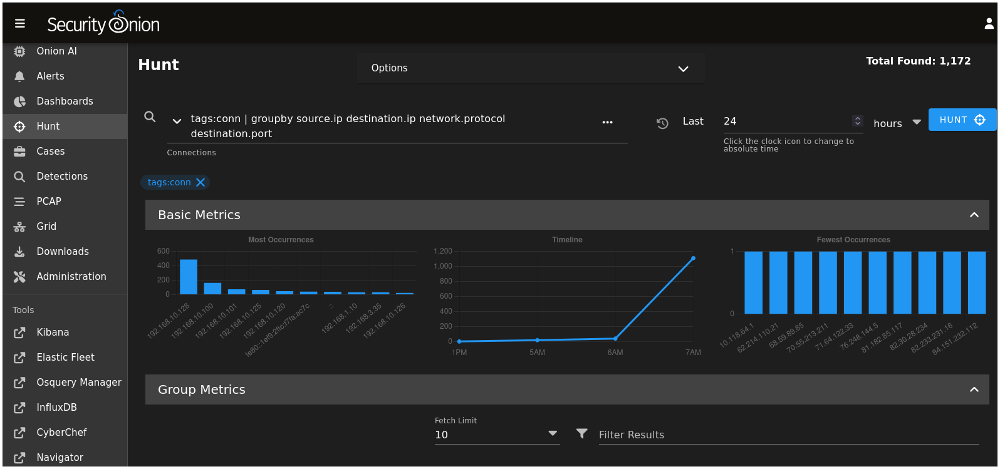

### Tipos de Log (índice de Elasticsearch: `logs-zeek-so`)

| Archivo de log | `event.dataset` | Qué registra |
|---|---|---|
| `conn.log` | `zeek.conn` | Cada flujo TCP/UDP/ICMP: duración, bytes transferidos, estado de la conexión |
| `dns.log` | `zeek.dns` | Consultas y respuestas DNS: dominio, tipo de registro, respuesta |
| `http.log` | `zeek.http` | Peticiones HTTP: método, URI, código de estado, user-agent, tamaño de la respuesta |
| `ssl.log` | `zeek.ssl` | Metadatos del handshake TLS: hostname SNI, conjunto de cifrado, validez del certificado |
| `files.log` | `zeek.files` | Transferencias de archivos observadas en el flujo: tipo MIME, hash MD5/SHA1, origen |
| `weird.log` | `zeek.weird` | Anomalías de protocolo que Zeek no puede interpretar correctamente |
| `notice.log` | `zeek.notice` | Detecciones de comportamiento propias de Zeek (p. ej. escaneo de puertos detectado) |

### Campos ECS Clave

| Campo ECS | Log | Uso típico en consultas |
|---|---|---|
| `source.ip` / `destination.ip` | conn, dns, http… | Quién habló con quién |
| `destination.port` | conn | Qué servicio fue el objetivo |
| `network.protocol` | conn | `tcp`, `udp`, `icmp` |
| `network.bytes` | conn | Total de bytes en el flujo |
| `dns.question.name` | dns | Nombre de dominio consultado |
| `dns.question.type` | dns | `A`, `AAAA`, `MX`, `TXT`… |
| `http.request.method` | http | `GET`, `POST`, `PUT`… |
| `http.request.body.uri` | http | Ruta URI solicitada |
| `http.response.status_code` | http | `200`, `404`, `500`… |
| `user_agent.original` | http | Cadena de user-agent del navegador o herramienta |
| `tls.server_name` | ssl | Hostname SNI del handshake TLS |
| `file.hash.md5` | files | Hash del archivo para búsquedas de inteligencia de amenazas |

### Consultas de Ejemplo en Hunt

```
# Todas las consultas DNS en la última hora
event.dataset: zeek.dns AND @timestamp > now-1h

# Todas las conexiones al puerto 445 (SMB — indicador de movimiento lateral)
event.dataset: zeek.conn AND destination.port: 445

# Peticiones HTTP que contienen un patrón de URI sospechoso
event.dataset: zeek.http AND http.request.body.uri: *passwd*

# Conexiones TLS donde el certificado era autofirmado o había expirado
event.dataset: zeek.ssl AND tls.established: false
```

---

## 1.2 — Suricata (Sistema de Detección de Intrusiones)

**Origen:** Open Information Security Foundation (OISF)
**Función:** IDS basado en firmas — compara el tráfico con patrones conocidos como maliciosos y genera alertas.

Suricata es la contraparte de **alertas** frente al registro pasivo de Zeek. Mientras Zeek registra todo lo que ve, Suricata se activa cuando el tráfico coincide con una regla de detección. SO incluye el conjunto de reglas **Emerging Threats Open** precargado. Suricata también escribe **capturas de paquetes completas (PCAP)** para cada alerta, permitiendo el análisis retrospectivo a nivel de paquete.

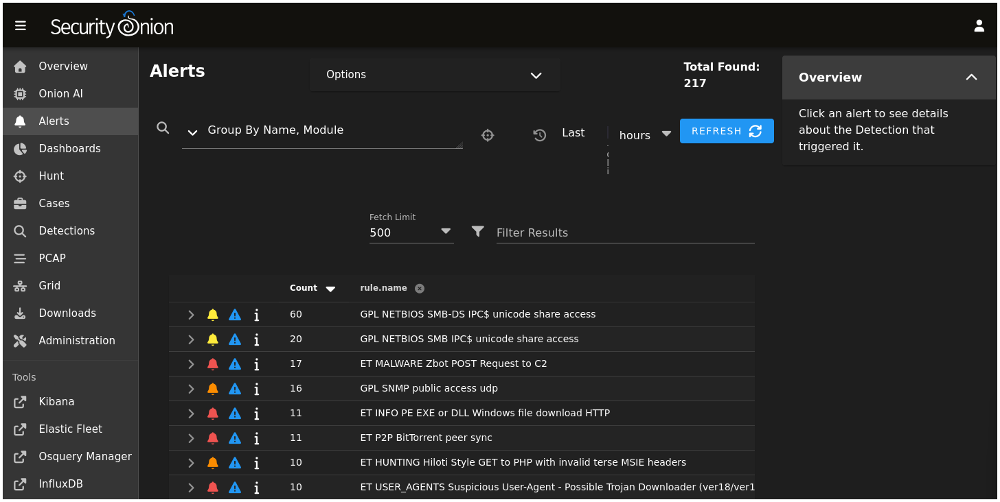

### Estructura de una Alerta

Cada alerta de Suricata incluye:

| Campo ECS | Significado |
|---|---|
| `rule.name` | Descripción legible de la regla (p. ej. `ET SCAN Nmap -sS window 2048`) |
| `rule.id` | SID numérico de Suricata |
| `rule.category` | Categoría de la alerta (p. ej. `Attempted Reconnaissance`) |
| `event.severity` | 1 = Crítica · 2 = Mayor · 3 = Menor · 4 = Informativa |
| `source.ip` / `destination.ip` | Atacante / objetivo |
| `destination.port` | Puerto del servicio objetivo |
| `network.transport` | `tcp` o `udp` |

### Escala de Severidad

| `event.severity` | Etiqueta | Significado |
|---|---|---|
| 1 | Crítica | Exploit activo o tráfico de malware confirmado |
| 2 | Mayor | Actividad sospechosa de alta confianza |
| 3 | Menor | Violaciones de política, patrones sospechosos de baja confianza |
| 4 | Informativa | Escaneo, reconocimiento, visibilidad general |

### Consultas de Ejemplo en Hunt

```
# Todas las alertas de Suricata
event.dataset: suricata.alert

# Solo alertas Críticas y Mayores
event.dataset: suricata.alert AND event.severity <= 2

# Alertas de una IP atacante específica
event.dataset: suricata.alert AND source.ip: 10.0.2.100

# Alertas que coinciden con una palabra clave en el nombre de la regla
event.dataset: suricata.alert AND rule.name: *scan*
```

---

## 1.3 — Logstash + Elasticsearch (Pipeline de Datos y Almacenamiento)

**Origen:** Elastic
**Función:** Analizar, normalizar e indexar todos los eventos de todas las fuentes.

Los estudiantes rara vez interactúan directamente con Logstash o Elasticsearch — son la "fontanería" invisible que hace que todo lo demás funcione.

**Logstash** recibe los datos de log en bruto de Zeek, Suricata y Elastic Agent, aplica reglas de análisis y mapea cada campo al **Elastic Common Schema (ECS)**. Este paso de normalización es la razón por la que una única consulta en Hunt como `source.ip: 10.0.2.100` devuelve resultados de Zeek, Suricata y Sysmon al mismo tiempo.

**Elasticsearch** almacena los eventos normalizados en **data streams** ordenados por tiempo:

| Data stream | Contenido |
|---|---|
| `logs-zeek-so` | Todos los logs de Zeek (conn, dns, http, ssl, files…) |
| `logs-suricata-so` | Alertas de Suricata y estadísticas de red |
| `logs-windows-so` | Logs de eventos de Windows + eventos de Sysmon |
| `logs-so.*` | Eventos internos de gestión y salud de SO |

En Hunt, selecciona **All Indices** para buscar en todos los streams, o limita la búsqueda a uno para reducir el ruido.

---

# CAPA 2 — Visibilidad de Host

Los sensores de red solo ven el tráfico que cruza el cable. Para observar qué ocurre **dentro de un endpoint** — qué procesos se ejecutaron, qué archivos se escribieron, qué claves de registro cambiaron — SO despliega agentes en los hosts monitorizados. Esta capa cubre esas herramientas de telemetría de endpoint.

---

## 2.1 — Elastic Agent (Recolector de Datos)

**Origen:** Elastic
**Función:** Agente unificado instalado en las VMs de los endpoints; recolecta y envía telemetría al Elasticsearch de SO.

Elastic Agent reemplaza a los antiguos agentes Beats (Winlogbeat, Filebeat) con un único binario desplegable. En los endpoints Windows de este laboratorio, recolecta logs de eventos de Windows, eventos de Sysmon y, opcionalmente, métricas de rendimiento. Se comunica con SO a través de un canal cifrado.

**Despliegue:** Los estudiantes obtienen el instalador desde **Downloads** en la barra lateral de SOC, inscriben la VM de Windows y verifican la conectividad en **Elastic Fleet**.

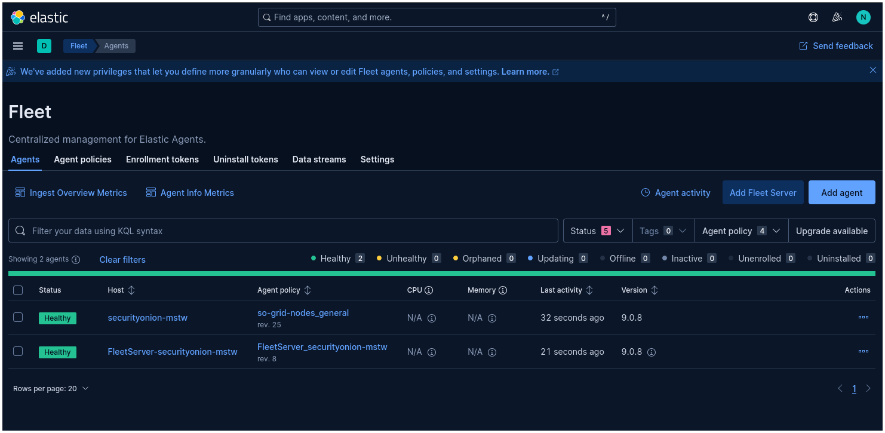

---

## 2.2 — Sysmon (System Monitor)

**Origen:** Microsoft Sysinternals
**Función:** Registro profundo de eventos de Windows — creación de procesos, conexiones de red, operaciones de archivos, cambios de registro y más.

Sysmon es un servicio de Windows que registra actividad detallada a nivel de sistema operativo en el Registro de Eventos de Windows. Elastic Agent recoge estos eventos y los envía a SO. Sysmon llena el vacío que dejan los logs de eventos estándar de Windows: sin él, se ven eventos de inicio de sesión y errores de aplicación, pero no qué procesos generaron qué procesos hijos ni qué DLLs se cargaron.

`<Insertar Captura: Vista Hunt mostrando un registro de Sysmon Event ID 1 (Process Create) con process.name, process.command_line y process.parent.name visibles>`

### IDs de Evento de Sysmon

| ID de Evento | Nombre | Qué registra |
|---|---|---|
| 1 | Process Create | Nuevo proceso: nombre, PID, padre, línea de comandos completa, hash de la imagen |
| 3 | Network Connection | Conexión de red saliente iniciada por un proceso |
| 5 | Process Terminate | Finalización de un proceso (emparejado con el Event ID 1) |
| 7 | Image Load | DLL cargada por un proceso (detecta DLL hijacking) |
| 8 | CreateRemoteThread | Hilo inyectado en otro proceso |
| 10 | ProcessAccess | Un proceso lee la memoria de otro proceso (indicador de volcado de credenciales) |
| 11 | File Create | Archivo creado o sobrescrito |
| 13 | Registry Value Set | Valor de una clave de registro modificado |
| 22 | DNS Query | Resolución de nombre DNS realizada por un proceso específico |

### Campos ECS Clave

| Campo ECS | IDs de Evento | Significado |
|---|---|---|
| `event.dataset` | todos | `windows.sysmon_operational` |
| `event.code` | todos | ID de Evento de Sysmon (p. ej. `1`, `3`, `22`) |
| `process.name` | 1, 3, 7… | Nombre del ejecutable |
| `process.command_line` | 1 | Línea de comandos completa con todos los argumentos |
| `process.executable` | 1 | Ruta completa al ejecutable |
| `process.parent.name` | 1 | Nombre del proceso padre |
| `process.hash.sha256` | 1 | Hash de la imagen para búsquedas de inteligencia de amenazas |
| `user.name` | 1, 11, 13 | Usuario del SO que provocó el evento |
| `host.name` | todos | Nombre de host del endpoint |
| `network.destination.ip` | 3 | IP de destino de la conexión saliente |
| `network.destination.port` | 3 | Puerto de destino de la conexión saliente |
| `dns.question.name` | 22 | Nombre de dominio resuelto por el proceso |
| `file.path` | 11 | Ruta del archivo creado o modificado |
| `registry.path` | 13 | Ruta de la clave de registro modificada |

### Consultas de Ejemplo en Hunt

```
# Todos los eventos de creación de procesos
event.dataset: windows.sysmon_operational AND event.code: 1

# PowerShell lanzado desde un padre sospechoso (p. ej. Word)
event.dataset: windows.sysmon_operational AND event.code: 1
  AND process.name: powershell.exe AND process.parent.name: winword.exe

# Conexiones salientes al puerto 4444 (puerto común de reverse shell)
event.dataset: windows.sysmon_operational AND event.code: 3
  AND network.destination.port: 4444

# Consultas DNS realizadas por cmd.exe (posible beaconing de C2)
event.dataset: windows.sysmon_operational AND event.code: 22
  AND process.name: cmd.exe
```

---

## 2.3 — Elastic Fleet

**Origen:** Elastic
**Función:** Consola de gestión centralizada para todos los despliegues de Elastic Agent.

Elastic Fleet es el plano de control de la capa de visibilidad de host. Muestra cada endpoint inscrito, su estado de salud, la política de integración aplicada (incluyendo qué fuentes de log se recolectan) y la versión del agente. Los estudiantes lo usan para confirmar que la VM víctima de Windows está inscrita y enviando datos activamente.


**Tareas clave:**
- Verificar que el agente de Windows muestre estado **Healthy** antes de comenzar un ejercicio de laboratorio
- Confirmar que la integración de Sysmon está activa en la política del agente
- Comprobar la hora del último check-in — una marca de tiempo desactualizada significa que el agente no está enviando datos

---

## 2.4 — Osquery Manager

**Origen:** osquery (Meta/Facebook, ahora de código abierto)
**Función:** Interrogación en vivo del host — consultar el estado actual del SO mediante SQL.

Osquery expone el sistema operativo como una base de datos relacional. Cada concepto del SO — procesos en ejecución, sockets abiertos, usuarios conectados, software instalado, tareas programadas, módulos del kernel cargados — es una tabla SQL que se puede consultar en tiempo real. El Osquery Manager de SO envía consultas a los endpoints inscritos y devuelve los resultados directamente en el navegador.

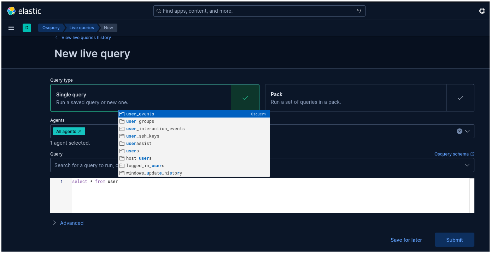

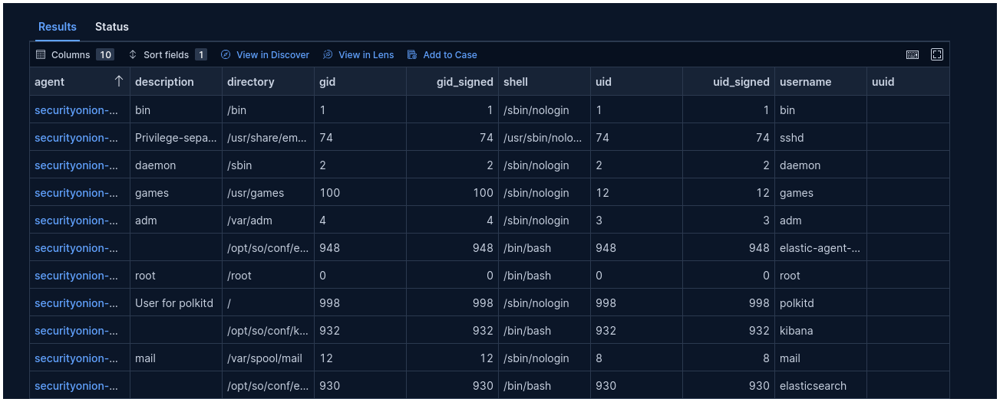

### Consultas de Ejemplo

```sql
-- ¿Qué está escuchando en la red ahora mismo?
SELECT pid, family, protocol, local_address, local_port, remote_address, remote_port, state
FROM process_open_sockets
WHERE state = 'LISTEN';

-- ¿Qué procesos se están ejecutando y quién los inició?
SELECT pid, name, path, cmdline, parent
FROM processes
ORDER BY start_time DESC
LIMIT 20;

-- ¿Hay tareas programadas sospechosas? (Windows)
SELECT name, action, path, enabled
FROM scheduled_tasks
WHERE enabled = 1;

-- ¿Qué software está instalado? (Windows)
SELECT name, version, install_date
FROM programs
ORDER BY install_date DESC;
```

### Sysmon vs. Osquery — Cuándo Usar Cada Uno

| | Sysmon | Osquery |
|---|---|---|
| **Tipo de dato** | Log de eventos histórico | Instantánea del estado actual del SO |
| **Pregunta que responde** | ¿Qué ocurrió, y cuándo? | ¿Qué es cierto ahora mismo? |
| **Mejor para** | Reconstrucción de la línea temporal de un ataque | Triaje en vivo y comprobación de IOCs |
| **¿Se almacena en Elasticsearch?** | Sí | Solo los resultados de la consulta, bajo demanda |

---

# CAPA 3 — La Interfaz Web de SOC

La **Security Onion Console (SOC)** es la interfaz unificada basada en navegador para interactuar con todos los datos recolectados por las Capas 1 y 2. Está construida sobre Kibana pero ampliamente personalizada por el equipo de SO.

**Acceso:** `https://<SO_MANAGEMENT_IP>` — inicia sesión con las credenciales de administrador establecidas durante la instalación de SO.

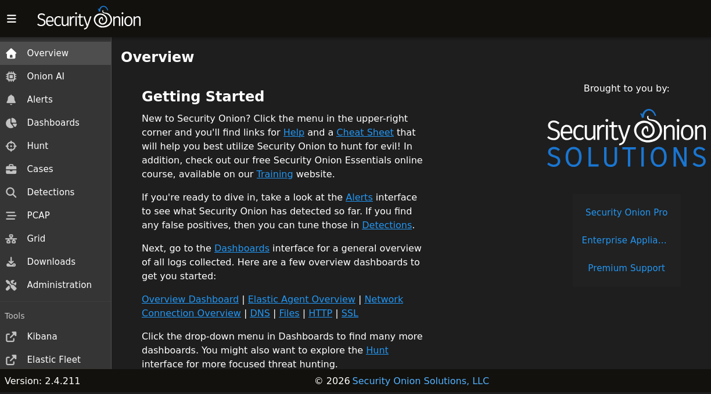

---

## 3.1 — Overview

La página de inicio de SOC. Muestra métricas de un vistazo: recuento de alertas por severidad, salud de los sensores, detecciones recientes y casos activos. Es la forma más rápida de evaluar la postura de amenazas actual sin ejecutar una consulta.


---

## 3.2 — Alerts

La vista principal de triaje para las alertas IDS de Suricata. Las alertas se agrupan por severidad y nombre de regla. Al expandir una fila de alerta se revela el registro ECS completo y se exponen botones de acción: abrir en Hunt, recuperar PCAP, adjuntar a un Case, o preguntar a Onion AI.

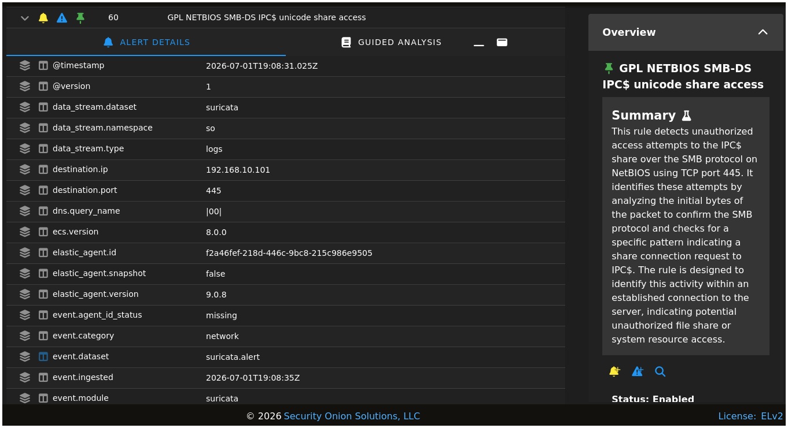

**Flujo de trabajo típico de triaje:**
1. Filtrar por severidad alta (`event.severity <= 2`)
2. Identificar la IP de origen y la categoría de la regla
3. Pivotar a Hunt para ver qué más estaba haciendo esa IP
4. Recuperar el PCAP si se necesita detalle a nivel de protocolo
5. Abrir un Case para documentar los hallazgos

---

## 3.3 — Hunt

Búsqueda libre en todos los data streams de Elasticsearch. Hunt es el espacio de trabajo de investigación principal — la interfaz de consulta del analista para correlacionar eventos entre Zeek, Suricata, Sysmon y cualquier otra fuente indexada.


### Lenguajes de Consulta

| Lenguaje | Mejor para |
|---|---|
| **KQL** (Kibana Query Language) | Filtrado simple `campo: valor` — punto de partida recomendado |
| **EQL** (Event Query Language) | Detección de secuencias — "proceso A, y luego en 30s proceso B en el mismo host" |
| **Lucene** | Búsqueda de texto avanzada con operadores de regex y fuzzy |

### Sintaxis de KQL

```
campo: valor                        # coincidencia exacta
campo: valor*                       # comodín de sufijo
campo: valor1 OR campo: valor2      # OR lógico
campo1: v1 AND campo2: v2           # AND lógico
NOT campo: valor                    # negación
campo >= 100                        # comparación numérica
```

### Patrones de Investigación Multi-Fuente

**Pivote de alerta → contexto de red**
```
# 1. Encontrar la alerta
event.dataset: suricata.alert AND source.ip: 10.0.2.100

# 2. ¿Qué otras conexiones hizo esa IP?
event.dataset: zeek.conn AND source.ip: 10.0.2.100

# 3. ¿Resolvió dominios sospechosos?
event.dataset: zeek.dns AND source.ip: 10.0.2.100
```

**Correlación proceso de endpoint → red**
```
# 1. Proceso sospechoso en el endpoint
event.dataset: windows.sysmon_operational AND event.code: 1 AND process.name: mshta.exe

# 2. ¿Qué conexiones de red hizo ese proceso?
event.dataset: windows.sysmon_operational AND event.code: 3 AND process.name: mshta.exe

# 3. Validar contra Zeek — ¿SO vio el mismo destino?
event.dataset: zeek.conn AND destination.ip: <IP del paso 2>
```

**Ventana temporal — todos los eventos en una ventana de ataque de 2 minutos**
```
@timestamp >= "2026-06-22T12:05:00" AND @timestamp <= "2026-06-22T12:07:00"
```

---

## 3.4 — Dashboards

Visualizaciones preconstruidas de solo lectura que agregan datos de todas las fuentes. Los Dashboards revelan tendencias y distribuciones de un vistazo — IPs de origen más frecuentes, volumen de alertas a lo largo del tiempo, frecuencia de consultas DNS, distribución de códigos de estado HTTP. Complementan a Hunt (que responde preguntas específicas) mostrando patrones que no se estaban buscando específicamente.

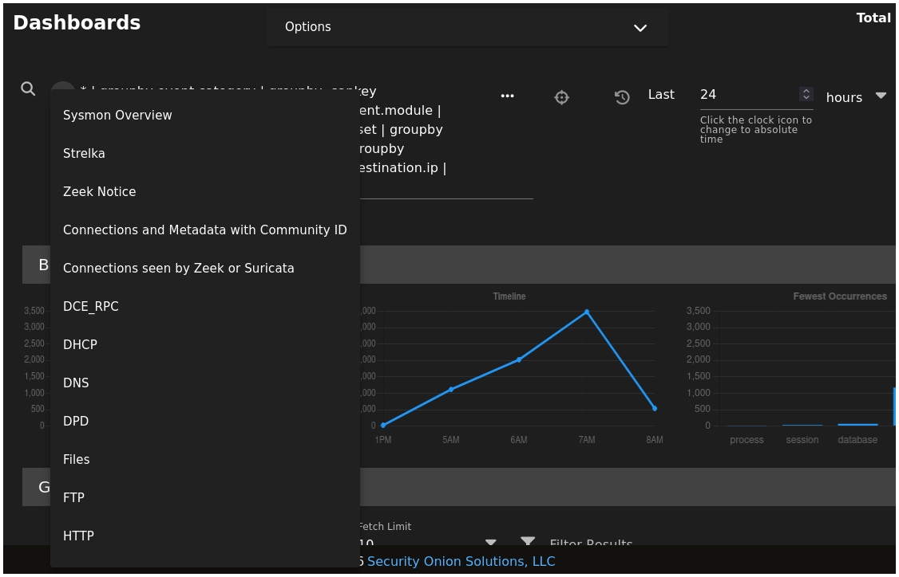

Los dashboards comunes incluyen: Network Overview, DNS Analysis, HTTP Traffic, Suricata Alert Trends, Endpoint Activity Summary.

---

## 3.5 — Cases

Gestión ligera de casos integrada en SOC. Los analistas crean casos para documentar una investigación — adjuntar alertas relevantes, añadir notas con marca de tiempo, establecer un estado (Open / In Progress / Closed) y asignar a un miembro del equipo. Los Cases no requieren un sistema de tickets externo.

`<Insertar Captura: Vista Cases mostrando un caso abierto con alertas adjuntas, notas del analista e indicador de estado>`

**Uso típico:** Después de que Hunt confirme actividad sospechosa, abrir un Case, adjuntar las alertas correlacionadas, documentar la cadena de ataque y registrar los pasos de remediación recomendados.

---

## 3.6 — PCAP

Recuperación de capturas de paquetes en bruto. Suricata captura los datos de paquete completos para cada alerta. La vista PCAP permite a los analistas recuperar una captura mediante una acción sobre una alerta o especificando manualmente un flujo (IP origen, IP destino, puertos, ventana de tiempo) y descargarlo como un archivo `.pcap` para su análisis en Wireshark.

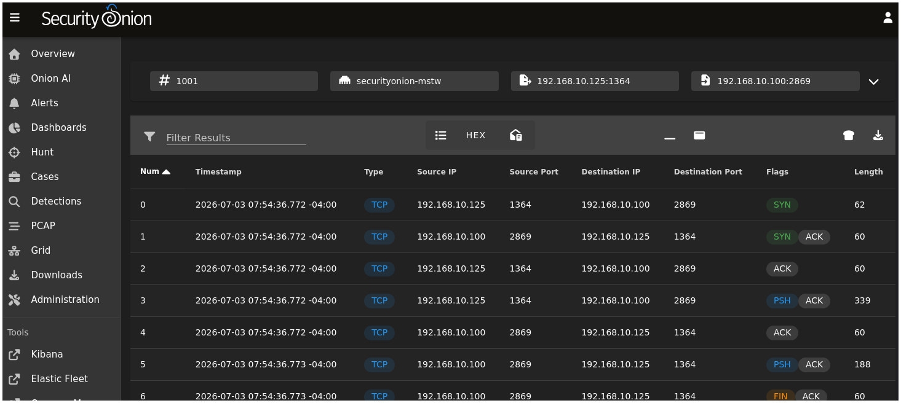

**Recuperación desde una alerta:**
1. Expandir una fila de alerta en **Alerts**.
2. Hacer clic en el icono PCAP.
3. SO localiza los paquetes almacenados para ese flujo y ofrece una descarga.
4. Abrir en Wireshark para la inspección a nivel de protocolo.

---

## 3.7 — Onion AI

Un panel de análisis asistido por LLM nativo de SOC. Onion AI puede resumir una alerta en lenguaje sencillo, explicar qué detecta una regla de Suricata, sugerir consultas de seguimiento en Hunt y proporcionar contexto de técnicas ATT&CK para el comportamiento observado. Opera sobre datos que ya están en Elasticsearch — no sale nada de la instancia de SO a menos que se configure un backend LLM remoto.

`<Insertar Captura: Panel Onion AI abierto junto a una alerta expandida, mostrando un resumen generado en lenguaje sencillo>`

> **Nota TFM:** Onion AI enriquece las alertas individuales de una en una. La capa de fusión del TFM enriquece **clústeres correlacionados multi-fuente** — un registro conn de Zeek, un evento de red de Sysmon y una alerta de Suricata que comparten la misma IP y ventana de tiempo, fusionados en un único objeto antes del enriquecimiento por LLM. La diferencia está en la unidad de análisis: evento único frente a clúster correlacionado.

---

## 3.8 — Grid

Muestra el estado de salud operativa y configuración de todos los nodos de SO. En un despliegue de laboratorio independiente hay un solo nodo. El indicador de advertencia de la navegación (⚠) señala un componente degradado o un problema de configuración. Los estudiantes deben comprobar Grid al comienzo de cada sesión y notificar cualquier advertencia al instructor antes de continuar.

`<Insertar Captura: Vista Grid mostrando la lista de nodos con indicadores de estado de componentes y cualquier advertencia activa resaltada>`

---

## 3.9 — Downloads

Proporciona los paquetes instaladores de Elastic Agent — el binario que los estudiantes despliegan en la VM víctima de Windows para inscribirla en la visibilidad de host. Disponible como `.exe` para Windows y `.rpm`/`.deb` para Linux.

---

## 3.10 — Administration

Superficie de configuración del sistema SO: gestión de usuarios, ajuste de sensores, configuración de componentes basada en Salt y gestión de licencias. Los estudiantes normalmente no entran en Administration durante los ejercicios de laboratorio — es el panel de configuración del instructor.

---

# CAPA 4 — Ingeniería de Detección

La Ingeniería de Detección en SO significa entender, ajustar y ampliar la capacidad de detección — saber qué reglas existen, por qué se activan, cómo suprimir el ruido, cómo decodificar payloads de atacantes y cómo mapear las técnicas observadas al framework ATT&CK. Esta capa cubre las herramientas que dan soporte a ese flujo de trabajo.

---

## 4.1 — Detections

La interfaz nativa de gestión de reglas de SO. La vista Detections lista todas las reglas de detección activas (firmas de Suricata y reglas Sigma), permite habilitar o deshabilitar reglas individuales, ajustar umbrales, suprimir falsos positivos para tráfico conocido como legítimo e importar reglas personalizadas.

`<Insertar Captura: Vista Detections mostrando la lista de reglas con interruptores de habilitar/deshabilitar, nombre de regla, conjunto de reglas de origen y marca de tiempo de última actualización>`

**Operaciones clave:**
- **Habilitar/deshabilitar reglas** — reducir el ruido de reglas irrelevantes para el entorno de laboratorio
- **Suprimir** — poner en lista blanca una IP de origen específica o una combinación de regla + IP para eliminar un falso positivo conocido
- **Importar reglas personalizadas** — añadir una regla Sigma (convertida automáticamente a una consulta ES) o un archivo `.rules` de Suricata en bruto
- **Actualizaciones de reglas** — aplicadas mediante `sudo soup` en el nodo manager de SO; actualiza tanto las reglas de Emerging Threats como las propias detecciones de SO

### Fuentes de Reglas en SO

| Fuente | Formato | Propósito |
|---|---|---|
| Emerging Threats Open | Suricata `.rules` | Firmas IDS de red para malware, exploits y C2 conocidos |
| Reglas de la comunidad SO | Sigma / Consulta ES | Detecciones de comportamiento basadas en endpoint y logs |
| Importadas personalizadas | Suricata o Sigma | Reglas específicas del laboratorio o de la organización |

---

## 4.2 — ATT&CK Navigator (MITRE)

**Origen:** MITRE Corporation
**Función:** Anotación visual de la matriz de técnicas de MITRE ATT&CK.

ATT&CK Navigator es una herramienta basada en navegador para mapear qué técnicas ATT&CK se han observado, detectado o siguen siendo puntos ciegos. Los analistas codifican por color las celdas de las técnicas para mostrar cobertura, carencias o alcance de un incidente.

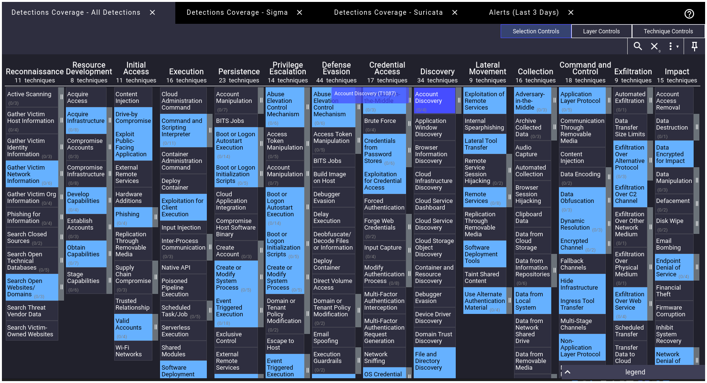

**En ingeniería de detección:**
- Marcar qué técnicas cubre el conjunto de reglas actual de SO (verde)
- Marcar qué técnicas se observaron en un escenario de ataque de laboratorio (rojo)
- Identificar carencias de cobertura — técnicas usadas en el escenario pero no detectadas por ninguna regla

**Uso en el laboratorio:** Después de ejecutar un escenario de Atomic Red Team, mapear cada técnica observada en la matriz. Comparar contra la cobertura de detección de SO. La carencia es la respuesta a: *"¿qué haría un atacante que SO pasaría por alto?"*

> **Conexión con el TFM:** El motor de fusión del TFM etiqueta cada clúster de eventos fusionado con IDs de técnicas ATT&CK. Navigator es la capa de visualización natural para mostrar una cadena de ataque multi-etapa producida por el motor de fusión.

---

## 4.3 — CyberChef (GCHQ)

**Origen:** GCHQ (Government Communications Headquarters del Reino Unido), código abierto
**Función:** Banco de trabajo de transformación y decodificación de datos basado en navegador.

La ingeniería de detección implica frecuentemente decodificar payloads de atacantes encontrados en los logs — comandos de PowerShell codificados en Base64 en eventos de Sysmon, shellcode codificado en hexadecimal en cuerpos de peticiones HTTP POST, scripts comprimidos, tráfico de C2 ofuscado con XOR. CyberChef encadena operaciones de transformación en una "receta" para decodificarlos paso a paso.

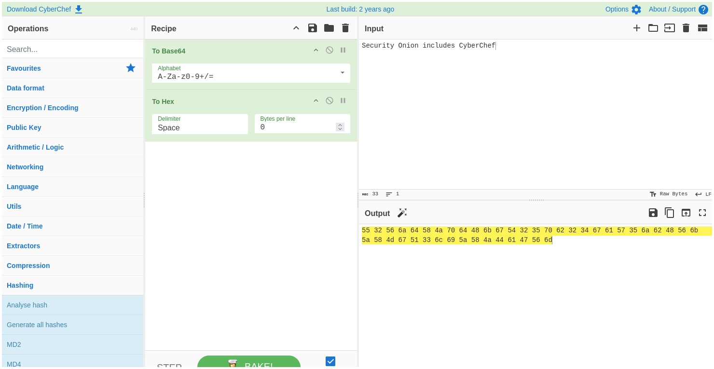

### Operaciones de Receta Comunes

| Operación | Caso de uso |
|---|---|
| From Base64 | Decodificar argumentos `-enc` de PowerShell codificados en Base64 |
| URL Decode | Decodificar caracteres codificados en porcentaje en URIs HTTP |
| From Hex | Decodificar shellcode o contenido de archivo representado en hexadecimal |
| Gunzip / Inflate | Descomprimir payloads comprimidos entregados en el flujo |
| To/From Charcode | Decodificar ofuscación por código de carácter |
| XOR Brute Force | Intentar recuperar payloads ofuscados con XOR |
| Extract IP addresses | Extraer IPs de un bloque de log en bruto |
| Magic | Autodetectar la codificación — útil cuando no se conoce el esquema de codificación |

**Flujo de trabajo:** Un Sysmon Event ID 1 muestra `process.command_line: powershell.exe -enc SQBuAHYAbwBrAGU...`. Pega el valor codificado en CyberChef → aplica `From Base64` → `Remove null bytes` → lee el comando en texto plano. Esto revela qué ejecutó realmente el atacante sin necesidad de ejecutar el payload.

---

## 4.4 — Kibana (Interfaz en Bruto)

**Origen:** Elastic
**Función:** Interfaz de análisis y visualización de Elasticsearch con todas las funciones — el motor que hay debajo de SOC.

La interfaz de SOC está construida sobre Kibana, pero la personalización de SO oculta muchas de las funciones nativas de Kibana. El enlace directo a Kibana (en la sección Tools de la barra lateral) evita esas personalizaciones y expone:

- **Discover** — navegador de documentos campo a campo con la lista completa de campos
- **Lens** — constructor de visualizaciones de arrastrar y soltar para dashboards personalizados
- **Dev Tools** — consola de la API REST de Elasticsearch para ejecutar consultas ES en bruto (`_search`, `_mapping`, `_stats`)
- **Index Management** — ver el tamaño de los data streams, la salud de los shards y las políticas de retención

`<Insertar Captura: Consola Kibana Dev Tools mostrando una consulta _search en bruto y su respuesta JSON>`

**Cuándo usar Kibana en bruto en lugar de Hunt:**
- Inspeccionar los mapeos de campos cuando una consulta en Hunt no devuelve resultados (el campo puede ser `keyword` en vez de `text`)
- Construir una visualización que no está disponible en la vista Dashboards de SO
- Ejecutar consultas de agregación (p. ej. "recuento de alertas por categoría de regla en los últimos 7 días") a través de la API REST de ES

---

## 4.5 — InfluxDB

**Origen:** InfluxData
**Función:** Base de datos de series temporales para las métricas de rendimiento del sistema de SO.

InfluxDB almacena la telemetría operativa propia de SO: consumo de CPU y memoria por componente, I/O de disco, rendimiento de red. Alimenta los indicadores de salud de los nodos visibles en Grid. Los estudiantes del laboratorio no consultan InfluxDB directamente — es una herramienta de administración de sistemas usada para diagnosticar problemas de rendimiento en el nodo de SO.

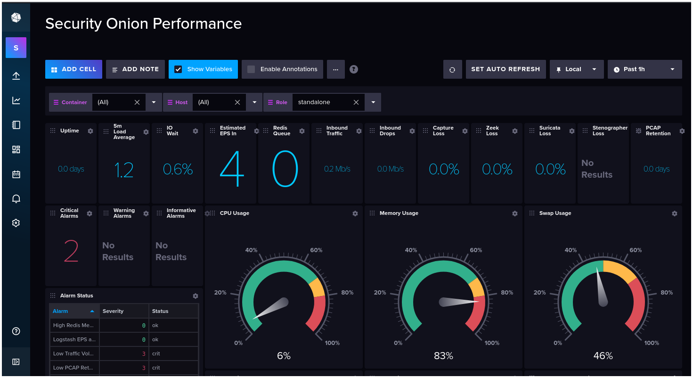

---

# Apéndice A — Tarjeta de Referencia Rápida de ECS

Todos los eventos de todas las fuentes terminan en Elasticsearch normalizados a ECS. Los campos siguientes aparecen en los registros de Zeek, Suricata y Sysmon.

| Campo | Tipo | Fuente principal | Valor de ejemplo |
|---|---|---|---|
| `@timestamp` | date | todas | `2026-06-22T12:06:33.000Z` |
| `event.dataset` | keyword | todas | `zeek.dns`, `suricata.alert`, `windows.sysmon_operational` |
| `event.code` | keyword | Sysmon | `1`, `3`, `22` |
| `event.severity` | long | Suricata | `1` (crítica) – `4` (informativa) |
| `source.ip` | ip | red | `10.0.2.100` |
| `source.port` | long | red | `54321` |
| `destination.ip` | ip | red | `93.184.216.34` |
| `destination.port` | long | red | `443` |
| `network.protocol` | keyword | Zeek conn | `tcp` |
| `network.transport` | keyword | Suricata | `tcp` |
| `dns.question.name` | keyword | Zeek dns, Sysmon 22 | `evil.example.com` |
| `http.request.body.uri` | keyword | Zeek http | `/admin/upload.php` |
| `tls.server_name` | keyword | Zeek ssl | `api.example.com` |
| `rule.name` | keyword | Suricata | `ET SCAN Nmap -sS` |
| `rule.id` | keyword | Suricata | `2000537` |
| `process.name` | keyword | Sysmon 1, 3… | `powershell.exe` |
| `process.command_line` | keyword | Sysmon 1 | `powershell.exe -enc SQBu…` |
| `process.parent.name` | keyword | Sysmon 1 | `winword.exe` |
| `user.name` | keyword | Sysmon | `VICTIM\jsmith` |
| `host.name` | keyword | Sysmon | `VICTIM-PC` |
| `file.path` | keyword | Sysmon 11 | `C:\Users\jsmith\evil.exe` |
| `registry.path` | keyword | Sysmon 13 | `HKLM\Software\Microsoft\…` |

---
